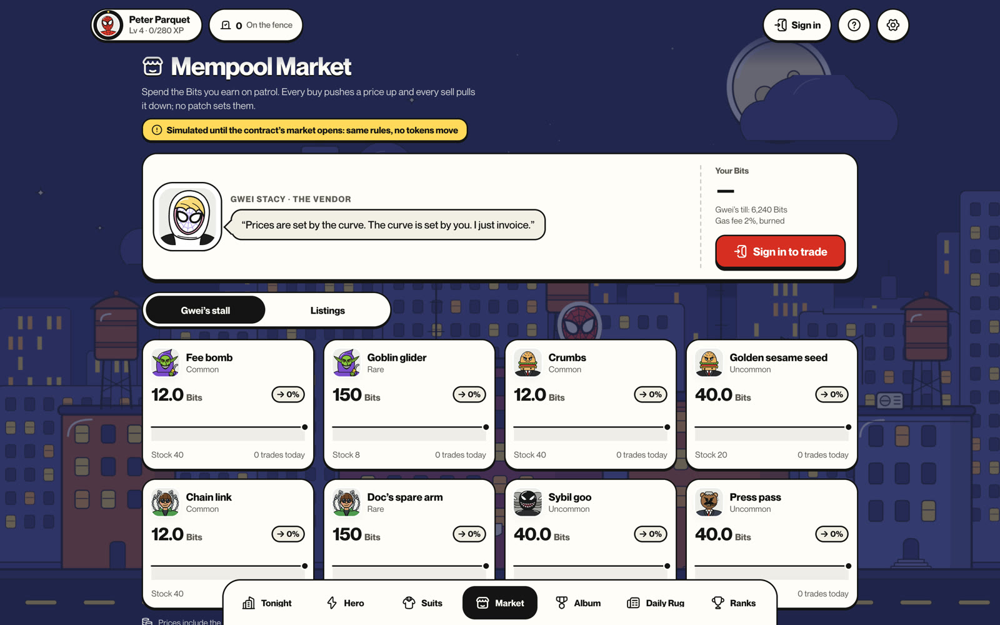

# With Great Power (WGP)

A 3D web-swinging superhero parody game on NEAR. You swing through a comic-book city at night, catch four parody villains, run errands for your neighbors, and climb leaderboards where **every ranked night is replayed and verified by the server**. Loot, suits, trophies and the in-game currency (Bits) are NEP-245 tokens in one NEAR mainnet contract. Players trade them with an NPC vendor whose prices move on a bonding curve. A game-only session key signs each trade and a relayer pays the gas, so players never see a gas prompt while they play.

- **Play:** https://www.wgponnear.fun (free, in the browser, no install)
- **Contract:** [`game.wgpnear.near`](https://nearblocks.io/address/game.wgpnear.near) on NEAR mainnet
- **Built at:** NEAR HACKATHON, Nov 1–14, 2026. Track: Games With Real Economies (`games`).
- **License:** MIT ([LICENSE](LICENSE))

## For judges: 5-minute check

Every check below is read-only: no sign-in, no wallet and no transaction. Commands A–C need `curl` and `jq` ([near-cli-rs](https://github.com/near/near-cli-rs) works too); D needs git, Node ≥ 22 and pnpm 10 (`corepack enable`).

| # | Claim | Do | See |
|---|---|---|---|
| 1 | The game runs in a browser, no install | Open https://www.wgponnear.fun/play, press **Get bitten**, pick a name, a suit and three powers, then press **Swing out** | A 3D night of four stops (two fights, two errands). It ends on a card saying **Banked. Get some sleep.** with an **Unranked score**. Guest nights stay in your browser and are never ranked. |
| 2 | The contract is live on mainnet | Open https://nearblocks.io/address/game.wgpnear.near | `mint_rewards` from `operator.wgpnear.near`, a `market_buy` from a player account, `set_market_params` and the deploy. The links are in [Proven on mainnet](#proven-on-mainnet). |
| 3 | The market lives in the contract | Run command A below | `{"open":true,"fee_bps":200,"pools":8,"prices_milli":[…]}`. Each price is in thousandths of a Bit, and the first one has moved off its starting 12000 since a player traded. |
| 4 | Players hold their items on chain | Run command B below | A player's NEP-245 tokens from verified nights: `item:bits`, loot such as `item:fee-bomb`, and the soulbound `trophy:badge:day-one`. |
| 5 | The game reads the market from the chain | Run command C below | `{"onChain":true,"network":"mainnet","contractId":"game.wgpnear.near",…}` |
| 6 | Ranked scores are reproducible | Run command D below | One `OK` line per run, then `N/N runs reproduced from https://www.wgponnear.fun` |
| 7 | Prices move without a patch | Open https://www.wgponnear.fun/lab/economy, choose **Instant** and press **Run 21 days** | **Day 21 / 21**, then the counters (Bits in play, Gwei's till, Bits burned, suits crafted, trades) and a price chart for each item, with some prices up and some down. It runs bot players on the market's own pricing code, in your browser. |
| 8 | The simulation is deterministic | Open https://www.wgponnear.fun/lab/determinism | **✓ All 4 replays match Node**: this browser replays four recorded nights and gets the same state hashes as Node. Checked in Chromium and WebKit. |

```bash
# A. The contract's market (NEAR JSON-RPC, read-only)
curl -s https://rpc.mainnet.near.org -H 'Content-Type: application/json' \
  -d '{"jsonrpc":"2.0","id":1,"method":"query","params":{"request_type":"call_function","finality":"final","account_id":"game.wgpnear.near","method_name":"market_state","args_base64":"e30="}}' \
  | jq -r '.result.result | implode' | jq -c '{open: .params.open, fee_bps: .params.fee_bps, pools: (.pools | length), prices_milli}'
# The same with near-cli-rs:
#   near contract call-function as-read-only game.wgpnear.near market_state json-args '{}' network-config mainnet now

# B. A player's tokens. sele.wgpnear.near is a Google player whose account the game's factory created;
#    sele71.near is a NEAR-wallet player.
curl -s https://rpc.mainnet.near.org -H 'Content-Type: application/json' \
  -d "{\"jsonrpc\":\"2.0\",\"id\":1,\"method\":\"query\",\"params\":{\"request_type\":\"call_function\",\"finality\":\"final\",\"account_id\":\"game.wgpnear.near\",\"method_name\":\"get_player\",\"args_base64\":\"$(printf '%s' '{"account_id":"sele.wgpnear.near"}' | base64)\"}}" \
  | jq -r '.result.result | implode' | jq -c '{level, reward_nonce, tokens}'
# → {"level":3,"reward_nonce":3,"tokens":[["item:fee-bomb","3"],…,["item:bits","151"],…]}  (it grows as they play)
# The same with near-cli-rs, plus one balance:
#   near contract call-function as-read-only game.wgpnear.near get_player json-args '{"account_id":"sele.wgpnear.near"}' network-config mainnet now
#   near contract call-function as-read-only game.wgpnear.near mt_balance_of json-args '{"account_id":"sele71.near","token_id":"item:fee-bomb"}' network-config mainnet now

# C. The live game's view of the market
curl -s https://www.wgponnear.fun/api/market | jq -c '{onChain, network, contractId, till}'

# D. Replay the All-time top 5 yourself (downloads each run's seed, start save and input log)
git clone https://github.com/71Labs/WithGreatPower && cd WithGreatPower
pnpm install --frozen-lockfile
pnpm --filter wgp exec tsx ../../scripts/verify-run.ts
```

Command D prints, for example:

```
OK    ee083ed4 hero-180a59: score 6315 vs 6315, ticks 6565 vs 6565, hash 5c1548b5 vs 5c1548b5
SKIP  b5f4b1ef sele71: recorded under ruleset 2; replay it from the tag (git checkout ruleset-v2)
1/1 runs reproduced from https://www.wgponnear.fun (1 from another ruleset skipped).
```

`SKIP` marks a run played under an older ruleset. To replay it, run `git checkout ruleset-v2 && pnpm install --frozen-lockfile`, then pass the full run id from `GET /api/leaderboard?board=alltime`, for example `pnpm --filter wgp exec tsx ../../scripts/verify-run.ts b5f4b1ef-64b2-419d-8887-80e27b24acef`. The 8-character prefix the script prints won't work.

## Screenshots

| | |
|---|---|
| <br>**Swing** across a comic-book city, then land and fight. | <br>**Boss fights**: Doc Octochain holds the bridge. |
| <br>**Real bodies**: MakeHuman characters with motion capture. | <br>**Sign in** with Google or a NEAR wallet. |
| <br>**Verified · Ranked**: the server replays the night before it counts. | <br>**Leaderboards**: Tonight, Season and All time. |
| <br>**Mempool Market**: an NPC vendor whose prices move with every trade. | <br>**Economy lab**: 21 days of bot trading on the real pricing code. |

## The problem

Web3 games make players fight wallets before villains: seed phrases, popups for every action, gas prompts mid-game. And their leaderboards trust whatever score the browser sends. WGP keeps the chain out of the game loop and makes scores verifiable:
- A player signs in once. After that, a game-only key signs their game actions and our relayer pays the gas.
- The server replays each ranked night's recorded inputs through the same deterministic simulation the browser ran, and ranks only what reproduces.
- Anyone can re-run that check (step 4 below).

## The economy loop

1. **Earn:** each verified night mints loot from the villains you caught, plus Bits: `floor(score / 100) + 5`, +25 on a level-up, +1 for each gold Bits token you swing through (up to 25), and at most 1,000 a night.
2. **Trade:** Gwei Stacy, an NPC vendor whose stock and till the contract holds, prices each item on a constant-product bonding curve. Buying raises the price, selling lowers it, and players can list items for each other.
3. **Burn:** a 2% "gas fee" on every trade is burned. Crafting a suit (`/play/suits`) burns the loot in its recipe.
4. **Nobody sets prices:** the price is wherever supply and demand leave the curve. `/lab/economy` fast-forwards weeks of this on the same pricing code.

## Try it: do X, see Y

All steps work on the live site, with no install.

1. **Play a night as a guest.**
   - **Do:** open https://www.wgponnear.fun/play. On a first visit, **Get bitten** walks you through a name, a suit and three powers, about a minute. Then press **Swing out** on Tonight.
   - **Controls:**
     - WASD or the arrow keys run relative to the camera. Let go and the hero stops and stands; he only moves where you steer.
     - Space or the mouse shoots a web toward where you're steering (or toward the next stop). Hold it to keep swinging and chain webs; let go to fly. Release on the rise for a perfect boost, and let go before touching a roof to land.
     - 1–4 fire powers, G calls Gwei, M opens the city map, and Esc or P pauses (How to play is in the pause menu). Click into the game for mouse look.
     - The minimap (bottom left) and a pin or edge arrow with the distance show where the next stop is.
     - On touch: drag on the left side to steer, and hold the right side to web.
   - **See:** a 3D night of four stops (villain fights and ally errands). Gold Bits tokens and boost rings line each route and build your combo. The night ends on **Banked. Get some sleep.**, with an **Unranked score**, stop-by-stop results and your loot. Guest nights are never ranked.
   - **Classic mode:** **Classic mode** on Tonight (or `/play/classic`) plays the same night turn by turn, for reduced motion or devices without WebGL. It's unranked.
2. **Sign in with Google or a NEAR wallet.**
   - **Do:** open the **Sign in** chip at the top of any game screen, then choose one:
     - **Continue with Google:** Privy logs you in with Google and gives you a NEAR key, with no seed phrase or extension. A new player picks a name, and the game's factory account `wgpnear.near` creates `<name>.wgpnear.near` holding that key plus a game-only session key.
     - **Use a NEAR wallet:** pick a wallet and sign one message (NEP-413). It's not a transaction and costs no gas.
   - **See:** the chip shows your handle. Your save now lives on the server.
3. **Play a ranked night.**
   - **Do:** finish a night while signed in.
   - **See:**
     - the results show **Verified** and **Ranked**, **Score, from the server**, your rank on Tonight's board and **You earned N Bits**;
     - the night's loot and Bits are minted to your NEAR account in the background of that request (or a later one), with nothing for you to sign. They show up in `get_player` (command B) and on NearBlocks as `mint_rewards` from `operator.wgpnear.near`;
     - https://www.wgponnear.fun/play/leaderboard lists you on the Tonight, Season and All-time boards;
     - the Season tab counts down to Season 1's start (Nov 5, 00:00 UTC), then to its end (nightly bests through Nov 14 add up). The top 10 at the close win soulbound trophies. After the close it shows the frozen final standings, with their Merkle root, the digest and the results file to check them.
4. **Verify any ranked run yourself.**
   ```bash
   pnpm install --frozen-lockfile
   pnpm --filter wgp exec tsx ../../scripts/verify-run.ts                  # the All-time top 5
   pnpm --filter wgp exec tsx ../../scripts/verify-run.ts <runId>          # one run: the full id from GET /api/leaderboard
   pnpm --filter wgp exec tsx ../../scripts/verify-run.ts --board tonight  # Tonight's board (also --top N, --base <url>)
   ```
   - **See:** `OK <run> <player>: score … vs …, ticks … vs …, hash … vs …` for each run and `N/N runs reproduced`. The script downloads the run's seed, start save and input log from `GET /api/runs/<id>/replay` and replays it locally with `@wgp/game-core`. It exits non-zero if any run doesn't reproduce.
   - **Older runs:** a run recorded under an older ruleset is skipped with a note. To replay it, check out that ruleset's tag: runs from before ruleset 3 need `git checkout ruleset-v2`.
5. **Trade in the Mempool Market.**
   - **Do:** open https://www.wgponnear.fun/play/market.
   - **See:**
     - **On NEAR mainnet · game.wgpnear.near**, Gwei's till, and each item's price, 24 h change, stock and trades today;
     - signed in, **Buy** and **Sell** move the price along the constant-product curve, and you can list items for other players;
     - each trade is a `market_buy`, `market_sell`, `list_item` or `buy_listing` call from your own account. It's signed by your session key, sent by `relayer.wgpnear.near` as a NEP-366 meta-transaction, and attaches no deposit. Google players get the session key at sign-up; wallet players press **Enable quick play** once, which is one wallet transaction that adds the key.
   - **Is it on chain?** `GET /api/market` says `onChain: true` when the contract's market is live, as it is in production. Without NEAR settings (a local checkout), the same engine runs in simulation and says `onChain: false`.
6. **Watch the economy move.**
   - **Do:** open https://www.wgponnear.fun/lab/economy, choose a speed (1×, 4×, 16× or Instant) and press **Run 21 days**.
   - **See:** 60 bot players patrol, buy, sell, list and craft for 21 days on the same pricing code. The page shows each item's price and Gwei's stock by day, plus the Bits in play, burned and crafted. The same seed always gives the same run: seed 2026, the default, ends with 1,173 trades and 10,021 of 98,255 earned Bits burned.
   - **One difference from mainnet:** the lab's **Crafting burns 25 Bits** option is on by default to show that sink. On mainnet, crafting burns only the recipe's items for now (`craft_bits` is `"0"` in `market_state`).
7. **Check it on NEAR.**
   - **Do:** open https://nearblocks.io/address/game.wgpnear.near.
   - **See:** the contract's NEP-245 `mt_mint`, `mt_transfer` and `mt_burn` events. A player's items and Bits come from `mt_balance_of` and `get_player` (command B).

## What NEAR does here

| Piece | How |
|---|---|
| **Player accounts** | A wallet player is their own NEAR account. A Google player gets a NEAR key from Privy's embedded wallet, and the game's factory account (`wgpnear.near`) creates `<name>.wgpnear.near` holding that key and a function-call session key for `game.wgpnear.near` only. Players who signed up before the factory went live play on the key's implicit account until they claim their name from the account sheet; their save, rank and held rewards move with them. |
| **Items, suits, trophies and Bits** | NEP-245 multi-tokens in one contract, `game.wgpnear.near` (`contracts/wgp`). Heroes and trophies are soulbound. Transfers need 1 yoctoNEAR and a function-call key can't attach a deposit, so a game key can never move a player's assets. |
| **Rewards** | Each verified night queues a reward mint (see [The economy loop](#the-economy-loop)). The operator account sends `mint_rewards` with a per-account nonce, so a retry never mints twice. Mints are sent in the background of player requests; there are no cron jobs. |
| **The Mempool Market** | An in-contract NPC vendor with a bonding curve per item, player listings held in escrow, and a 2% "gas fee" parody that's burned. Guards cap what a stolen game key could do: listing prices within 50–400% of the vendor's, daily trade and fill caps, and at most 20 items a call. |
| **No popups in play** | After sign-in, players hold a game-only function-call key. Our relayer submits their signed actions as NEP-366 meta-transactions and pays the gas. `/api/relay/meta` accepts exactly one function call to an allowlisted method, with zero deposit, at most 30 Tgas and within budgets. |
| **Sign-in** | NEAR wallets go through near-connect with a NEP-413 signed message. Google goes through Privy: the server verifies Privy's access token and reads the player's verified email and NEAR key from Privy's API. Players are linked by verified email, so a later switch from Privy to NEAR Auth keeps every hero. |
| **Seasons** | The first player request after a season's end, plus 50 minutes for runs already in flight, closes it once. The final standings are frozen with their Merkle root, and `record_season` (root, results digest, top 10) is queued in the outbox. The operator sends it; the contract stores it for good and mints a soulbound `trophy:<season>:<rank>` to each of the top 10. The results file, with every leaf's proof, is at `/api/seasons/<id>/results`, and `scripts/near/record-season.ts` recomputes the same root. |

### Status (mainnet, checked 2026-11-03)

| | |
|---|---|
| **Proven on mainnet** (transactions below) | The contract `game.wgpnear.near` and its market (8 pools, 2% fee); reward mints from `operator.wgpnear.near`, Bits included; a Google player's account created by the factory `wgpnear.near` with a game-only session key; a session-key trade relayed by `relayer.wgpnear.near` (NEP-366), with its fee burned |
| **Live, in code and tests, not yet seen on mainnet** | `register_hero`, `craft_suit` and `equip_suit` through the session key; `market_sell`, listings and fills; `record_season` and its trophies, which first happen when Season 1 closes (Nov 15, 00:50 UTC or the first request after) |
| **Live off chain** | The game, ranked runs verified by replay, the Tonight, Season and All-time boards, Google sign-in (Privy), NEAR wallet sign-in (NEP-413), classic mode and the full soundtrack |
| **Simulation by design** | `/lab/economy`, which fast-forwards bot players on the same pricing code |
| **Waiting on approval** | NEAR Auth as a second Google sign-in path (its mainnet client) |

### Proven on mainnet

| What | Transaction |
|---|---|
| Deploy and `new` (code hash `68F7NhEjUtKweyLU7WNvT183apacLQegfB1DXUoQ2hjJ`, owner `wgpnear.near`, operator `operator.wgpnear.near`) | [`8nyXGMNu…`](https://nearblocks.io/txns/8nyXGMNuFmQkvwJyC9PZv1JVM54Go45QZ69HXXppC1JR) |
| `set_market_params`: opens the market and mints Gwei's stock and till (`mt_mint`) | [`FdQxVNyz…`](https://nearblocks.io/txns/FdQxVNyziV7ioNWPAfL9yAWJ8u2wDN3kRKpEX4JSVcCR) |
| First `mint_rewards`: a NEAR-wallet player's Day-one trophy (for importing their guest save) and a ranked night's loot (`sele71.near`, nonces 1–2) | [`5ohT4xpU…`](https://nearblocks.io/txns/5ohT4xpUzrVFW15d9Hk8Qy9XTZJTE5zKXCeSxJbXrMxZ) |
| The factory creates a Google player's account, `sele.wgpnear.near`, with their Privy key and a session key for `game.wgpnear.near` | [`CY6esX2A…`](https://nearblocks.io/txns/CY6esX2ALc9qoDqSVBkuHP29ovDSZpH32C7cLaYL48iT) |
| That player's held rewards, Bits included (nonces 1–3) | [`Bi8HjZda…`](https://nearblocks.io/txns/Bi8HjZdajH5pH4k8a9TZd37UA2DFgft9hxog2xxtVfYM) |
| A `market_buy` signed by the player's session key, relayed by `relayer.wgpnear.near` as a delegate action: `mt_transfer` of 13 Bits to the till and the item back, `mt_burn` of the 1-Bit fee | [`GxuFQYCX…`](https://nearblocks.io/txns/GxuFQYCX7DzCFRXenpQuhfxz1hUekf9t2FapLjCUeMXn) |

## How verification works

1. **One simulation.** `packages/game-core` is a deterministic simulation: a 60 Hz fixed step, trig-free math (polynomial sin, cos and atan2 in `sim3d/dmath.ts`), and integer HP and score. The browser and the server share it.
2. **Recording.** The browser records only inputs: a stick direction, a magnitude, web held, and one-shot powers. They're run-length encoded, usually 2–15 KB a night.
3. **Starting a run.** `POST /api/runs/start` issues a server-signed seed. A player has at most one active run and 20 ranked runs a day.
4. **Verifying.** `POST /api/runs/<id>/submit` replays the log from that seed and the server's copy of the save. It checks the ruleset, at least 20 seconds of game time, game time within wall-clock time plus 60 seconds, and that the browser's final state hash matches. Then it ranks the server's score, not the client's.
5. **Anyone can re-check.** Every verified run's replay is public at `GET /api/runs/<id>/replay` (`seed`, `startSave`, `log`, `score`, `ticks`, `hash`).

More: [docs/ARCHITECTURE.md](docs/ARCHITECTURE.md).

## Run it locally

**You need:** Node ≥ 22 (CI uses 24), pnpm 10.19 (`corepack enable` picks the version in `package.json`), and Rust through [rustup](https://rustup.rs) for the contract tests (`contracts/wgp/rust-toolchain.toml` installs Rust 1.95 and the wasm target on first use). No database, keys or accounts.

```bash
pnpm install --frozen-lockfile
echo "ALLOW_DEV_AUTH=1" > apps/wgp/.env.local    # turns on the local test sign-in; nothing else is needed
pnpm dev                                         # http://localhost:3000/play  (another port: PORT=3680 pnpm dev)
```

- **Database:** local dev uses PGlite (Postgres in a folder, `apps/wgp/.data/pglite`) and applies the migrations itself, so no database or keys are needed.
- **Signing in locally:** in the sign-in sheet, **Play as a test player** gives you a test account. Make a hero, finish a night, and you'll see **Verified · Ranked** from your own server. Check it with `pnpm --filter wgp exec tsx ../../scripts/verify-run.ts --base http://localhost:3000 --board tonight`.
- **What stays off locally:** with no NEAR keys the market runs in simulation (`onChain: false`) and nothing is sent on chain. Google and wallet sign-in need the Privy and NEAR settings in `apps/wgp/.env.example`.
- **Production:** uses Neon Postgres, Privy, and the mainnet accounts listed in `apps/wgp/.env.example`.

| Command | What it does |
|---|---|
| `pnpm test` | Unit and integration tests for game-core (simulation, golden replays, the input log, a bot across 30 nights) and the app (server, verifier, market, relayer abuse cases, outbox, season close). The app's tests run on in-memory PGlite. |
| `pnpm typecheck` / `pnpm lint` | TypeScript across the workspace, and ESLint for the app |
| `pnpm build` | The production build of the app; needs no environment variables |
| `cd contracts/wgp && cargo test --locked` | Contract unit tests (expect `test result: ok`) |
| `cd contracts/wgp && cargo near build non-reproducible-wasm && cd sandbox && cargo test -- --test-threads=1` | Sandbox tests of the real wasm with near-workspaces; needs [cargo-near](https://github.com/near/cargo-near) 0.22 |
| `cd apps/wgp && pnpm simulate 14` | A bot plays 14 nights of the turn-based rules engine (classic mode) and prints each night's results |
| `scripts/near/setup-mainnet.sh` | Owner only: creates the mainnet accounts, deploys the contract and opens the market. Spends real NEAR. |

CI (`.github/workflows/ci.yml`) runs the same gates on every push to `main`, with no secrets.

## Layout

```
packages/game-core/   deterministic simulation, input log, replay verifier, scoring (TypeScript)
apps/wgp/             Next.js 16 app: 3D client (React Three Fiber), API routes, Drizzle (Neon / PGlite), NEAR wiring
contracts/wgp/        NEAR contract (near-sdk 5.30): NEP-245 core, rewards, crafting, Mempool Market, seasons
contracts/wgp/sandbox near-workspaces tests of the built wasm
scripts/              run verification (verify-run.ts), mainnet setup and chain end-to-end tests (near/), a local load test (load/)
launch/brand/hero/    Blender pipeline that builds the characters (MakeHuman bodies) and retargets motion capture
docs/                 architecture, spike results and README screenshots
```

**Pages:** `/` (landing), `/play` (Tonight), `/play/patrol` (the 3D night), `/play/classic`, `/play/bitten` (onboarding), `/play/hero`, `/play/suits` (crafting), `/play/market`, `/play/album`, `/play/rug` (The Daily Rug, the in-game paper), `/play/leaderboard`. Labs: `/lab/economy`, `/lab/determinism`, and the 3D test benches `/lab/cast` and `/lab/city`, which the launch-video tooling also uses.

## Built during the hackathon

- **New code, written during NEAR HACKATHON.** The repository's first commit is 2026-11-01 and every commit since is from the build window, which opened with the announcement on 2026-10-19 (Q-001). This repository is the whole submission, so there's no pre-hackathon diff to separate (Q-003).
- **Adapted from the author's own earlier projects** (Q-005 baseline):
  - from the game *blastoff*: the fixed-step loop and input-log approach, the quality tiers, GPU check and FPS probe (`apps/wgp/src/game3d/scene/quality.ts`), WebGL context-loss recovery (`scene/context-recovery.ts`), the camera springs (`scene/camera/springs.ts`) and the API route helpers (`apps/wgp/src/server/http.ts`);
  - from *Vessel*, an earlier project of the author's (built Oct 30, after the announcement): the landing page's design tokens and frame (`apps/wgp/src/app/globals.css`), the shader canvas and the near-connect wallet wrapper (`apps/wgp/src/lib/near/wallet.tsx`).
- **Scaffold:** the app began as a standard Next.js 16 scaffold. No game, Web3 or UI template was used.

## Credits and disclosure

- **AI-written code:** Claude Code (Anthropic) wrote much of this repository's code, tests, art-pipeline scripts, docs and copy under the team's direction. The team set the design and the rules, reviewed the changes, and playtested every build. The commits carry no AI trailers, so this is the disclosure.
- **AI-generated audio:** the soundtrack, sound effects and character voices were generated with ElevenLabs on the owner's paid plan (`apps/wgp/public/audio/CREDITS.md`).
- **Main libraries:**
  - App: Next.js 16 (with the React Compiler), React 19, three.js 0.187, React Three Fiber 9 and drei 10, Drizzle ORM and drizzle-kit, Neon serverless and PGlite, zod 4, Tailwind CSS 4 and Hugeicons.
  - NEAR and sign-in: near-api-js 7, @hot-labs/near-connect, Privy (`@privy-io/react-auth`, `@privy-io/node`) and the @fast-auth-near (NEAR Auth) SDKs.
  - Tests and tools: Vitest and tsx.
  - Contract: near-sdk-rs 5.30, cargo-near 0.22 and near-workspaces 0.24.
- **Services:** Vercel (hosting), Neon (Postgres), Privy (Google login and embedded NEAR keys), and the FastNEAR and NEAR public RPC endpoints.
- **3D characters:** bodies were made with [MakeHuman](http://www.makehumancommunity.org/) through MPFB in Blender (CC0 assets; the GPL tool isn't shipped). Motion capture is from [Quaternius' Universal Animation Library](https://quaternius.com/packs/universalanimationlibrary.html) (CC0). See `apps/wgp/public/models/LICENSES.md`.
- **Fonts:** Neue Montreal (Pangram Pangram) is licensed and served in production but isn't in this repository; without it the site falls back to Inter. Inter, Manrope and Geist Mono are from Google Fonts (OFL).
- **NEAR wordmark:** from NEAR's brand files.
- **Parody:** all characters are original designs. With Great Power isn't affiliated with, endorsed by or sponsored by any comic book publisher or film studio.
