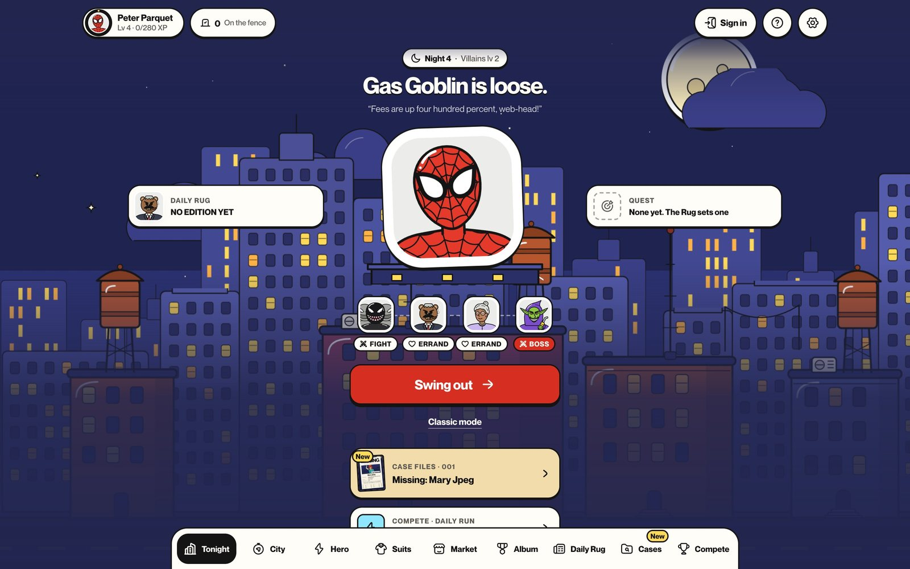
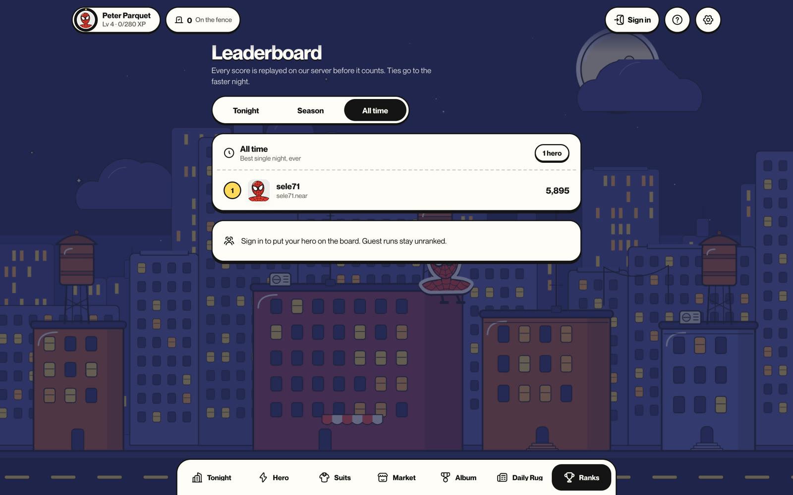
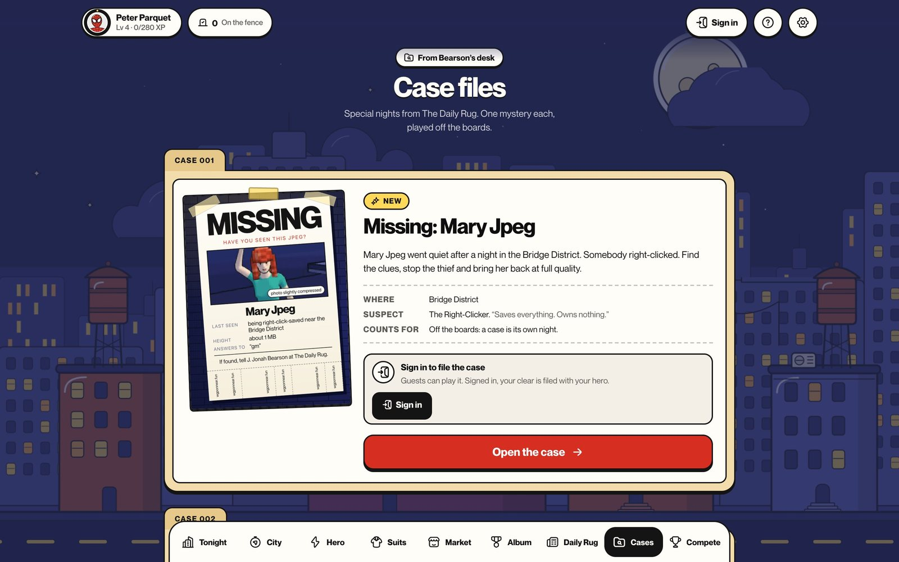
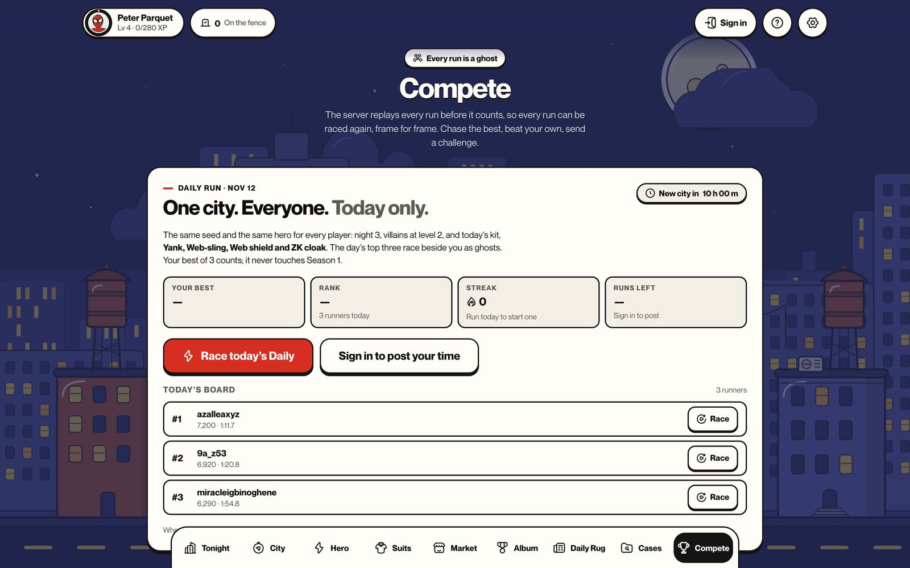
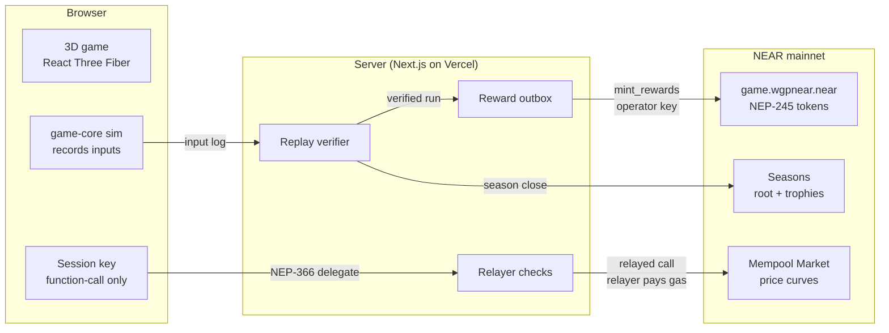

# With Great Power (WGP)

A 3D web-swinging superhero parody game on NEAR mainnet. You swing through a comic-book city at night, fight parody villains, run errands for your neighbours and trade what you win with an NPC vendor whose prices move with every trade. **Every ranked score is replayed and verified by the server**, and everything you earn is a NEP-245 token in one contract. You sign in with Google, and after that you never see a wallet popup, a seed phrase or a gas prompt.

| | |
|---|---|
| **Play** | https://www.wgponnear.fun (free, in the browser, no install) |
| **Contract** | [`game.wgpnear.near`](https://nearblocks.io/address/game.wgpnear.near) on NEAR mainnet |
| **Live numbers** | https://www.wgponnear.fun/stats, or `GET /api/stats` |
| **Track** | NEAR HACKATHON, Nov 1–14, 2026: Games With Real Economies (`games`) |
| **License** | MIT ([LICENSE](LICENSE)) |

**Contents:** [Track fit](#how-it-meets-the-track) · [5-minute check](#for-judges-5-minute-check) · [Numbers](#by-the-numbers) · [Screenshots](#screenshots) · [Game loop](#the-game-loop) · [Economy](#the-economy-loop) · [Ways to play](#ways-to-play) · [Try it](#try-it-do-x-see-y) · [NEAR](#what-near-does-here) · [Verification](#how-verification-works) · [Run locally](#run-it-locally) · [Layout](#layout) · [Disclosures](#built-during-the-hackathon)

## How it meets the track

The track's prompt (["Games With Real Economies"](https://github.com/nearai/near-hackathon-prompt-examples/blob/main/tracks/09-games.md)) lists what to build. Each line below says where it is in WGP and how to check it.

| The track asks for | In WGP | Check |
|---|---|---|
| Judged on the game loop, not the token | A real-time 3D action game: swing, fight, climb, race. 8 ways to play. | Play a guest night at `/play` (check 1). The loop on paper: [docs/GAME-LOOP.md](docs/GAME-LOOP.md) |
| Bonus if players never notice the chain | Google sign-in, a game-only session key, a relayer that pays gas. No popup after sign-in. | [Try it](#try-it-do-x-see-y), steps 2, 3 and 5 |
| Items are NEP-245 multi tokens, one contract for every item type | Heroes, suits, loot, Bits, badges and trophies are all token ids in `game.wgpnear.near` | Check 4 (command B) |
| Social or email login, no seed phrases, popups or gas prompts in the loop | Google through Privy; NEAR wallets also work with one signed message | Step 2 |
| NPCs with wallets | Gwei Stacy, the vendor: her stock and her till are NEP-245 balances held by the contract account | Check 3 (command A) shows each pool's `stock` and `bits` |
| Merchant sets prices from stock and demand | A constant-product curve per item: buying raises the price, selling lowers it | [`contracts/wgp/src/market.rs`](contracts/wgp/src/market.rs) |
| Pricing rules in one readable file | [`apps/wgp/src/lib/market/math.ts`](apps/wgp/src/lib/market/math.ts) mirrors the contract's maths line for line; both test against the same vectors | Read the file's first 15 lines |
| A merchant's reasoning appears in a tooltip | **Why this price?** on every item in the market: Gwei explains the price from her real stock and till | `/play/market`, press **Why this price?** |
| A merchant that goes broke stops trading | Gwei sells only what she holds and pays only from her till; sold out or broke, she says so and the button explains why | `/lab/economy` shows it happen |
| Player-owned markets | Players list items for each other; the contract holds them in escrow | `list_item` and `buy_listing` transactions (command D) |
| Economies that evolve without a dev patch | Prices are contract state and move with every trade. No deploy, no cron job. | Command A: prices have moved off their starting values |
| A fast-forward mode | `/lab/economy` runs 60 bot players for 21 days on the same pricing code | Check 7 |

## For judges: 5-minute check

Every check is read-only: no sign-in, no wallet, no transaction. Commands A–E need `curl` and `jq`. F and G need git, Node ≥ 22 and pnpm 10 (`corepack enable`).

| # | Claim | Do | See |
|---|---|---|---|
| 1 | The game runs in a browser, no install | Open https://www.wgponnear.fun/play, press **Get bitten**, pick a name, a suit and three powers, then press **Swing out** | A 3D night of four stops (two fights, two errands). It ends on a card saying **Banked. Get some sleep.** with an **Unranked score**. Guest nights stay in your browser and are never ranked. |
| 2 | The contract is live and used by players | Run command D | Calls from player accounts (`register_hero`, `craft_suit`, `equip_suit`, `market_buy`, `market_sell`, `list_item`, `buy_listing`) and `mint_rewards` from `operator.wgpnear.near` |
| 3 | The market lives in the contract | Run command A | `{"open":true,"fee_bps":200,"pools":8,"prices_milli":[…]}`. Prices are in thousandths of a Bit. Several have moved off their starting values because players traded. |
| 4 | Players hold their items on chain | Run command B | A player's NEP-245 tokens: `hero:…`, `item:bits`, loot such as `item:fee-bomb`, a crafted `suit:…`, and soulbound badges such as `trophy:badge:daily-podium` |
| 5 | The game reads the market from the chain | Run command C | `{"onChain":true,"network":"mainnet","contractId":"game.wgpnear.near",…}` |
| 6 | Ranked scores are reproducible | Run command F | One `OK` line per run, then `5/5 runs reproduced from https://www.wgponnear.fun.` |
| 7 | Prices move without a patch | Open https://www.wgponnear.fun/lab/economy, choose **Instant** and press **Run 21 days** | **Day 21 / 21**, the counters (Bits in play, Gwei's till, Bits burned, suits crafted, trades), a price chart per item and Gwei's reasoning for each price |
| 8 | The simulation is deterministic | Open https://www.wgponnear.fun/lab/determinism | **✓ All 4 replays match Node**: your browser replays four recorded nights and gets the same state hashes as Node |
| 9 | The numbers in this README are real | Run command G (about a minute), or open https://www.wgponnear.fun/stats | The live counts from the game's database, then the contract's calls counted by method from NearBlocks |

```bash
# A. The contract's market (NEAR JSON-RPC, read-only)
curl -s https://rpc.mainnet.near.org -H 'Content-Type: application/json' \
  -d '{"jsonrpc":"2.0","id":1,"method":"query","params":{"request_type":"call_function","finality":"final","account_id":"game.wgpnear.near","method_name":"market_state","args_base64":"e30="}}' \
  | jq -r '.result.result | implode' | jq -c '{open: .params.open, fee_bps: .params.fee_bps, pools: (.pools | length), prices_milli}'

# B. A player's tokens. sele.wgpnear.near is a Google player whose account the game's factory created.
curl -s https://rpc.mainnet.near.org -H 'Content-Type: application/json' \
  -d "{\"jsonrpc\":\"2.0\",\"id\":1,\"method\":\"query\",\"params\":{\"request_type\":\"call_function\",\"finality\":\"final\",\"account_id\":\"game.wgpnear.near\",\"method_name\":\"get_player\",\"args_base64\":\"$(printf '%s' '{"account_id":"sele.wgpnear.near"}' | base64)\"}}" \
  | jq -r '.result.result | implode' | jq -c '{level, reward_nonce, tokens}'
# → {"level":4,"reward_nonce":5,"tokens":[["hero:sele.wgpnear.near","1"],["item:bits","244"],["suit:snow","1"],["trophy:badge:daily-podium","1"],…]}  (it grows as they play)

# C. The live game's view of the market
curl -s https://www.wgponnear.fun/api/market | jq -c '{onChain, network, contractId, till}'

# D. The contract's latest transactions (NearBlocks API)
curl -s 'https://api.nearblocks.io/v1/account/game.wgpnear.near/txns?per_page=25' \
  | jq -r '.txns[] | "\(.transaction_hash)  \(.predecessor_account_id)  \([.actions[]? | .method // .action] | join(","))"'

# E. One relayed session-key trade's events (NEAR JSON-RPC): mt_transfer, mt_burn of the fee, market_trade
curl -s https://rpc.mainnet.near.org -H 'Content-Type: application/json' \
  -d '{"jsonrpc":"2.0","id":1,"method":"tx","params":{"tx_hash":"GxuFQYCX7DzCFRXenpQuhfxz1hUekf9t2FapLjCUeMXn","sender_account_id":"relayer.wgpnear.near","wait_until":"FINAL"}}' \
  | jq -r '.result.receipts_outcome[].outcome.logs[]'

# F. Replay the All-time top 5 yourself (downloads each run's seed, start save and input log)
git clone https://github.com/71Labs/WithGreatPower && cd WithGreatPower
pnpm install --frozen-lockfile
pnpm verify

# G. The live numbers, and the contract's transactions counted from NearBlocks
pnpm stats            # site only: curl -s https://www.wgponnear.fun/api/stats | jq   ·   chain only: pnpm stats --chain-only
```

Command F printed this from a fresh clone on Nov 12:

```
OK    46ffe6cf azalleaxyz: score 15995 vs 15995, ticks 4237 vs 4237, hash 183a3432 vs 183a3432
OK    d80003d4 9a_z53: score 12430 vs 12430, ticks 4046 vs 4046, hash b489e56a vs b489e56a
OK    a255f138 ambactamwkwk: score 7880 vs 7880, ticks 4795 vs 4795, hash 2636c9bd vs 2636c9bd
OK    8f9855e7 nasibabalili7: score 7590 vs 7590, ticks 3290 vs 3290, hash e4341dda vs e4341dda
OK    10864077 hossinshabani1389: score 7235 vs 7235, ticks 5608 vs 5608, hash 666c4d9f vs 666c4d9f
5/5 runs reproduced from https://www.wgponnear.fun.
```

A `SKIP` line marks a run played under an older ruleset. To replay one, check out the tag the note names (`git checkout ruleset-v3` or `ruleset-v2`, then `pnpm install --frozen-lockfile`) and pass the full run id from `GET /api/leaderboard?board=alltime`: `pnpm verify <runId>`.

## By the numbers

Real players, counted two ways. Neither needs trust in us: the first is the public chain, the second is a public endpoint you can re-run.

**On NEAR mainnet** (counted from NearBlocks on Nov 12; `pnpm stats` recounts):

| | |
|---|---|
| Calls to `game.wgpnear.near` | 215 (2 of them failed) |
| Player accounts that called a game method themselves | 17 |
| `mint_rewards` (verified nights' loot, Bits and badges) | 157 |
| `register_hero` | 18 |
| `craft_suit` / `equip_suit` | 16 / 7 |
| Market: `market_buy`, `market_sell`, `list_item`, `buy_listing` | 2, 1, 4, 4 |

**In the game** (<!-- STATS-DATE -->Nov 9, 17:04 UTC<!-- /STATS-DATE -->; live at [`/api/stats`](https://www.wgponnear.fun/api/stats)):

| | |
|---|---|
| Matches started / finished and verified | 200 / 178 |
| Runs rejected by the verifier | 0 |
| Free-roam City outings | 274 |
| Heroes | 25 (22 have finished a match) |
| Verified play time | 4.9 hours |
| Verified matches by mode | Ranked nights 97 · Daily Run 44 · Case files 24 · Time trials 13 |

Play sessions (matches plus City outings) doubled between Nov 7 and Nov 9: 237 to 474.

## Screenshots

| | |
|---|---|
| <br>**Swing** across a comic-book city, then land and fight. | <br>**Boss fights**: Doc Octochain holds the bridge. |
| <br>**Tonight**: the hub for nights, cases, races, the City and invites. | <br>**The City**: free roam with climbing, wall-runs, traffic and six side tasks. |
| <br>**Verified · Ranked**: the server replays the night before it counts. | <br>**Leaderboards**: Tonight, Season and All time. |
| <br>**Mempool Market**: an NPC vendor whose prices move with every trade. | <br>**Economy lab**: 21 days of bot trading on the real pricing code. |
| <br>**Case files**: three story chapters, each with a soulbound badge. | <br>**Compete**: the Daily Run, time trials and ghost duels. |
| <br>**Sign in** with Google or a NEAR wallet. | <br>**Real bodies**: MakeHuman characters with motion capture. |

## The problem

Web3 games make players fight wallets before villains: seed phrases, a popup for every action, gas prompts mid-game. Their leaderboards trust whatever score the browser sends, and their economies are a token chart with a game attached.

WGP is built the other way round:
- **The game comes first.** It's a full 3D action game you can finish a night of as a guest, with no account.
- **The chain stays out of the loop.** A player signs in once. After that a game-only key signs their game actions and our relayer pays the gas.
- **Scores are proven, not claimed.** The server replays each ranked night's inputs through the same deterministic simulation the browser ran, and ranks only what reproduces. Anyone can re-run that check.
- **The economy is play.** Loot comes from the villains you beat, suits need specific loot, and the vendor's prices are set by what players buy and sell.

## The game loop

The full design is in [docs/GAME-LOOP.md](docs/GAME-LOOP.md). In short:

| Every | The player | The economy |
|---|---|---|
| **30 seconds** | Swings, lands, climbs, dodges, punches, fires a power | Gold Bits tokens and boost rings on the route |
| **5 minutes** | Finishes a night of four stops; the server replays and ranks it | Loot and Bits are minted to their NEAR account in the background |
| **Session** | Trades with Gwei, lists items, crafts a suit, climbs the boards | Prices move with each trade, 2% of each trade is burned, recipes burn loot |

## The economy loop

1. **Earn.** Each verified night mints loot from the villains you caught, plus Bits: `floor(score / 100) + 5`, +25 on a level-up, +1 for each gold Bits token you swing through (up to 25), and at most 1,000 a night.
2. **Trade.** Gwei Stacy, an NPC vendor whose stock and till the contract holds, prices each item on a constant-product curve. Buying raises her price and selling lowers it. Players can also list items for each other, at 50–400% of her price.
3. **Burn.** A 2% "gas fee" on every trade is burned. Crafting a suit (`/play/suits`) burns the loot in its recipe.
4. **Nobody sets prices.** A price is wherever supply and demand leave the curve. Gwei explains each one (**Why this price?**), sells only what she holds and pays only from her till.

The curve, in [`apps/wgp/src/lib/market/math.ts`](apps/wgp/src/lib/market/math.ts) and [`contracts/wgp/src/market.rs`](contracts/wgp/src/market.rs):

```
x = virtual_items + stock        y = virtual_bits + bits        spot price = y / x Bits
buy n:   ceil(y·n / (x − n))     only from her stock
sell n:  floor(y·n / (x + n))    only from her till
fee:     ceil(bits · 200 / 10000), burned
```

A round trip never profits, because a buy rounds up and a sell rounds down.

## Ways to play

Every mode's runs are replayed by the server. The right-hand column is what each puts on NEAR.

| Mode | What it is | On NEAR |
|---|---|---|
| **Ranked nights** (`/play/patrol`) | Patrol the city: two villain fights and two errands | `item:bits` and loot for each verified night |
| **Daily Run** (`/play/compete`) | The same city for everyone, new each UTC day, 3 tries | `trophy:badge:daily-podium` for the day's top 3, `daily-winner` for first |
| **Time trials** | Five courses with medal times | Nothing: verified boards only |
| **Duels** | Race the ghost of any player's verified run | Nothing: ghosts are real replays |
| **Case files** (`/play/cases`) | Three story chapters: Missing: Mary Jpeg, The Sybil Vote, Fee Strike | `trophy:badge:case-00N` on your first verified clear |
| **The City** (`/play/city`) | Free roam: run, sprint, climb, wall-run, swing, dodge traffic, six side tasks | Nothing: XP, saved with your hero |
| **Invite 3 friends** (`/play/invite`) | Friends who add their X and play a verified night count | `trophy:badge:recruiter` |
| **Season 1** (Nov 5–14) | Nightly bests add up on the Season board | The final board's root and digest, recorded once; `trophy:s1:1…10` for the top 10 |

Design docs: [chapters](docs/chapters/) · [the story bible](docs/story/bible.md) · [competitive modes](docs/compete.md) · [referrals](docs/referrals.md).

## Try it: do X, see Y

All steps work on the live site, with no install.

1. **Play a night as a guest.**
   - **Do:** open https://www.wgponnear.fun/play. On a first visit, **Get bitten** walks you through a name, a suit and three powers, about a minute. Then press **Swing out** on Tonight.
   - **Controls:**
     - WASD or the arrow keys run relative to the camera. Let go and the hero stops.
     - Space or the mouse shoots a web toward where you're steering. Hold it to swing and chain webs; let go to fly.
     - 1–4 fire powers, G calls Gwei, M opens the city map, and Esc or P pauses (How to play is in the pause menu). Click into the game for mouse look.
     - On touch: the left stick steers, a finger anywhere else looks around, and the right side webs.
   - **See:** a 3D night of four stops. Gold Bits tokens and boost rings line each route. The night ends on **Banked. Get some sleep.**, with an **Unranked score**, stop-by-stop results and your loot.
   - **Classic mode:** `/play/classic` plays the same night turn by turn, for reduced motion or devices without WebGL. It's unranked.
2. **Sign in with Google or a NEAR wallet.**
   - **Do:** open the **Sign in** chip at the top of any game screen, then choose one:
     - **Continue with Google:** Privy logs you in with Google and gives you a NEAR key, with no seed phrase or extension. A new player picks a name, and the game's factory account `wgpnear.near` creates `<name>.wgpnear.near` holding that key plus a game-only session key.
     - **Use a NEAR wallet:** pick a wallet and sign one message (NEP-413). It's not a transaction and costs no gas.
   - **See:** the chip shows your handle. Your save now lives on the server.
3. **Play a ranked night.**
   - **Do:** finish a night while signed in.
   - **See:**
     - the results show **Verified** and **Ranked**, **Score, from the server**, your rank on Tonight's board and **You earned N Bits**;
     - the night's loot and Bits are minted to your NEAR account in the background, with nothing for you to sign. They show up in `get_player` (command B) and on NearBlocks as `mint_rewards` from `operator.wgpnear.near`;
     - https://www.wgponnear.fun/play/leaderboard lists you on the Tonight, Season and All-time boards.
4. **Verify any ranked run yourself.**
   ```bash
   pnpm install --frozen-lockfile
   pnpm verify                    # the All-time top 5
   pnpm verify <runId>            # one run: the full id from GET /api/leaderboard
   pnpm verify --board tonight    # Tonight's board (also --top N, --base <url>)
   ```
   - **See:** `OK <run> <player>: score … vs …, ticks … vs …, hash … vs …` for each run and `N/N runs reproduced`. The script downloads the run's seed, start save and input log from `GET /api/runs/<id>/replay` and replays it locally with `@wgp/game-core`. It exits non-zero if any run doesn't reproduce.
5. **Trade in the Mempool Market.**
   - **Do:** open https://www.wgponnear.fun/play/market.
   - **See:**
     - **On NEAR mainnet · game.wgpnear.near**, Gwei's till, and each item's price, 24 h change, stock and trades today;
     - **Why this price?** on any item: Gwei's reasoning from her real stock and till;
     - signed in, **Buy** and **Sell** move the price along the curve, and you can list items for other players;
     - each trade is a `market_buy`, `market_sell`, `list_item` or `buy_listing` call from your own account. It's signed by your session key, sent by `relayer.wgpnear.near` as a NEP-366 meta-transaction, and attaches no deposit. Google players get the session key at sign-up; wallet players press **Enable quick play** once.
   - **Is it on chain?** `GET /api/market` says `onChain: true` when the contract's market is live, as it is in production. Without NEAR settings (a local checkout), the same engine runs in simulation and says `onChain: false`.
6. **Watch the economy move.**
   - **Do:** open https://www.wgponnear.fun/lab/economy, choose a speed (1×, 4×, 16× or Instant) and press **Run 21 days**.
   - **See:** 60 bot players patrol, buy, sell, list and craft for 21 days on the same pricing code, with mainnet's settings (2% gas fee, crafting burns no Bits) and the contract's rule that a hero crafts each suit once. The page shows Bits earned against Bits burned, each item's price and Gwei's stock by day, her reasoning, and the Bits in play, burned and crafted. The same seed always gives the same run.
   - **The inflation, and the fix:** with mainnet's settings about 3% of the Bits earned are burned. Tick **Recommended settings** (crafting burns 250 Bits, 5% gas fee) and run again: about 29%. Those settings are not on mainnet yet; [docs/ECONOMY.md](docs/ECONOMY.md) has the measurements, the owner's command and what stays unfixed.
   - **Gwei's limits:** press **Drain Gwei** and run 30 days. A crowd of hoarders and dumpers leaves her sold out of rares and unable to buy the rest, and the page counts the item-days.
7. **Roam the City.**
   - **Do:** open https://www.wgponnear.fun/play/city. Shift sprints, F webs while held, Q zips, E talks or interacts, M opens the map.
   - **See:** a free-roam city where walls are climbable, barriers and cars are solid (a car at speed knocks you down), and six people have tasks, such as racing Sandwich Man over the roofs with Gwei's order, or unplugging Doc Octochain's relays from the city's highest points.
8. **Open a case file, race the Daily, invite a friend.**
   - **Do:** `/play/cases`, `/play/compete`, `/play/invite`.
   - **See:** three story chapters with their own rules and bosses; today's Daily Run with other players' ghosts; your invite link and its 0/3 progress (signed in).
9. **Check it on NEAR.**
   - **Do:** open https://nearblocks.io/address/game.wgpnear.near.
   - **See:** the contract's NEP-245 `mt_mint`, `mt_transfer` and `mt_burn` events, and calls from player accounts.

## What NEAR does here



| Piece | How |
|---|---|
| **Player accounts** | A wallet player is their own NEAR account. A Google player gets a NEAR key from Privy's embedded wallet, and the game's factory account (`wgpnear.near`) creates `<name>.wgpnear.near` holding that key and a function-call session key for `game.wgpnear.near` only. |
| **Items, suits, trophies and Bits** | NEP-245 multi-tokens in one contract, `game.wgpnear.near` (`contracts/wgp`). Heroes and trophies are soulbound. Transfers need 1 yoctoNEAR and a function-call key can't attach a deposit, so a game key can never move a player's assets. |
| **Rewards** | Each verified night queues a reward mint in the same database transaction. The operator account sends `mint_rewards` in batches of up to 20, each with a per-account nonce, so a retry never mints twice. Mints are sent in the background of player requests; there are no cron jobs. |
| **The Mempool Market** | An in-contract NPC vendor with a curve per item, player listings held in escrow, and a 2% fee that's burned. Guards cap what a stolen game key could do: listing prices within 50–400% of the vendor's, daily trade and fill caps, and at most 20 items a call. |
| **No popups in play** | After sign-in, players hold a game-only function-call key. Our relayer submits their signed actions as NEP-366 meta-transactions and pays the gas. `/api/relay/meta` accepts exactly one function call to an allowlisted method, with zero deposit, at most 30 Tgas and within budgets. |
| **Sign-in** | NEAR wallets go through near-connect with a NEP-413 signed message. Google goes through Privy: the server verifies Privy's access token and reads the player's verified email and NEAR key from Privy's API. |
| **Seasons** | The first player request after a season's end, plus 50 minutes for runs in flight, closes it once. The final standings are frozen with their Merkle root, and `record_season` (root, results digest, top 10) is queued. The contract stores it for good and mints a soulbound `trophy:<season>:<rank>` to each of the top 10. The results file, with every leaf's proof, is at `/api/seasons/<id>/results`. |
| **Safe upgrades** | near-sdk's `Promise` links host functions mainnet doesn't have yet, which failed our first deploy. `upgrade` uses low-level `env::promise_*` calls, and `scripts/near/check-wasm-imports.mjs` refuses a wasm that imports them. |

### Status on mainnet (checked Nov 12, 2026)

| | |
|---|---|
| **Used by players on mainnet** (transactions below) | The contract and its market (8 pools, 2% fee); reward mints, Bits and badges included; player accounts created by the factory with session keys; `register_hero`, `craft_suit` and `equip_suit`; `market_buy`, `market_sell`, `list_item` and `buy_listing`, all signed by session keys and relayed (NEP-366) |
| **Live in code and tests, first runs at the season's close** | `record_season` and its trophies: Season 1 closes Nov 15, 00:50 UTC, or on the first request after |
| **Live off chain** | The game and all its modes, runs verified by replay, the boards, Google sign-in (Privy), NEAR wallet sign-in (NEP-413), referrals, classic mode and the soundtrack |
| **Simulation by design** | `/lab/economy`, which fast-forwards bot players on the same pricing code |
| **Waiting on approval** | NEAR Auth as a second Google sign-in path (its mainnet client) |

### Proven on mainnet

| What | Transaction |
|---|---|
| Deploy and `new` (code hash `68F7NhEjUtKweyLU7WNvT183apacLQegfB1DXUoQ2hjJ`, owner `wgpnear.near`, operator `operator.wgpnear.near`) | [`8nyXGMNu…`](https://nearblocks.io/txns/8nyXGMNuFmQkvwJyC9PZv1JVM54Go45QZ69HXXppC1JR) |
| `set_market_params`: opens the market and mints Gwei's stock and till | [`FdQxVNyz…`](https://nearblocks.io/txns/FdQxVNyziV7ioNWPAfL9yAWJ8u2wDN3kRKpEX4JSVcCR) |
| The factory creates a Google player's account with their Privy key and a session key | [`CY6esX2A…`](https://nearblocks.io/txns/CY6esX2ALc9qoDqSVBkuHP29ovDSZpH32C7cLaYL48iT) |
| `mint_rewards` from the operator (one of 157) | [`CsnUWQDW…`](https://nearblocks.io/txns/CsnUWQDWSXGwNaapB9iFGH3idEqzQWGbWmrH7pbJegZh) |
| A player's `register_hero` | [`7dnP8eU7…`](https://nearblocks.io/txns/7dnP8eU7W8b9LdQeZztnttzai5uUc7gHAea4hEeoXnnq) |
| A player's `craft_suit`, burning the recipe's loot | [`AfRNvujJ…`](https://nearblocks.io/txns/AfRNvujJ43dmk9Rj9LzzCZUxWqU4UnkvozaqWqtN2eq2) |
| A player's `equip_suit` | [`C2WwQsHy…`](https://nearblocks.io/txns/C2WwQsHyHNBZLrkN1JaVDGZuuf9aYaBJGqvyMSLvRvRp) |
| A `market_buy` from Gwei, with the fee burned | [`ASmRJdKZ…`](https://nearblocks.io/txns/ASmRJdKZy3fMPAPNNogcABL4Wdr7CiPPasAxRjXr5xRq) |
| A `market_sell` to Gwei | [`GDATLg4Q…`](https://nearblocks.io/txns/GDATLg4Qr2cqQZ9S5uaRwZJTup4Y54P7uPyzJzFGaqXE) |
| A player `list_item` (escrowed in the contract) | [`GhK2jtPK…`](https://nearblocks.io/txns/GhK2jtPKtNpHgjcn93eYRiFjF72mcMcFzbfHqYbnM9tx) |
| Another player's `buy_listing`: a player-to-player trade | [`Heu9ZTQv…`](https://nearblocks.io/txns/Heu9ZTQvWmriDngtPQ37defMDZMJSecgBNpdAuLnMdu9) |

## How verification works

1. **One simulation.** `packages/game-core` is a deterministic simulation: a 60 Hz fixed step, trig-free maths (polynomial sin, cos and atan2 in `sim3d/dmath.ts`), and integer HP and score. The browser and the server share it. A test scans it for sources of non-determinism.
2. **Recording.** The browser records only inputs: a stick direction, a magnitude, web held, and one-shot powers. They're run-length encoded, usually 2–15 KB a night.
3. **Starting a run.** `POST /api/runs/start` issues a server-signed seed. A player has at most one active run and 20 ranked runs a day.
4. **Verifying.** `POST /api/runs/<id>/submit` replays the log from that seed and the server's copy of the save. It checks the ruleset, at least 20 seconds of game time, game time within wall-clock time plus 60 seconds, and that the browser's final state hash matches. Then it ranks the server's score, not the client's.
5. **Rulesets are pinned.** Season 1 plays on ruleset 4. Each mode has its own ruleset tag (cases, trials, the City), so a log from one mode never replays as another. Recorded golden runs must replay byte-identical before a change ships.
6. **Anyone can re-check.** Every verified run's replay is public at `GET /api/runs/<id>/replay` (`seed`, `startSave`, `log`, `score`, `ticks`, `hash`).

More: [docs/ARCHITECTURE.md](docs/ARCHITECTURE.md).

## Run it locally

**You need:** Node ≥ 22 (CI uses 24), pnpm 10.19 (`corepack enable` picks the version in `package.json`), and Rust through [rustup](https://rustup.rs) for the contract tests. No database, keys or accounts.

```bash
pnpm install --frozen-lockfile
echo "ALLOW_DEV_AUTH=1" > apps/wgp/.env.local    # turns on the local test sign-in; nothing else is needed
pnpm dev                                         # http://localhost:3000/play  (another port: PORT=3680 pnpm dev)
```

- **Database:** local dev uses PGlite (Postgres in a folder, `apps/wgp/.data/pglite`) and applies the migrations itself.
- **Signing in locally:** in the sign-in sheet, **Play as a test player** gives you a test account. Make a hero, finish a night, and you'll see **Verified · Ranked** from your own server. Check it with `pnpm verify --base http://localhost:3000 --board tonight`.
- **What stays off locally:** with no NEAR keys the market runs in simulation (`onChain: false`) and nothing is sent on chain. Google and wallet sign-in need the Privy and NEAR settings in `apps/wgp/.env.example`.

| Command | What it does | Expect |
|---|---|---|
| `pnpm test` | Unit and integration tests: the simulation and its golden replays, the server, verifier, market, relayer abuse cases, reward outbox, season close and referrals. The app's tests run on in-memory PGlite. | game-core 283 passed, app 1,048 passed |
| `pnpm typecheck` / `pnpm lint` | TypeScript across the workspace, and ESLint for the app | No output |
| `pnpm build` | The production build of the app; needs no environment variables | The route list |
| `pnpm verify` | Replays the live All-time top 5 | `5/5 runs reproduced` |
| `pnpm stats` | Prints the live game numbers and counts the contract's transactions | A table |
| `cd contracts/wgp && cargo test --locked` | Contract unit tests | `test result: ok. 68 passed` |
| `cd contracts/wgp && cargo near build non-reproducible-wasm && cd sandbox && cargo test -- --test-threads=1` | Sandbox tests of the real wasm with near-workspaces; needs [cargo-near](https://github.com/near/cargo-near) 0.22 | `test result: ok` |
| `scripts/near/setup-mainnet.sh` | Owner only: creates the mainnet accounts, deploys the contract and opens the market. Spends real NEAR. | |

CI (`.github/workflows/ci.yml`) runs typecheck, lint, tests, the build and the contract tests on every push to `main`, with no secrets.

## Layout

```
packages/game-core/    deterministic simulation, input log, replay verifier, scoring (TypeScript)
apps/wgp/              Next.js 16 app: 3D client (React Three Fiber), API routes, Drizzle (Neon / PGlite), NEAR wiring
contracts/wgp/         NEAR contract (near-sdk 5.30): NEP-245 core, rewards, crafting, Mempool Market, seasons
contracts/wgp/sandbox  near-workspaces tests of the built wasm
scripts/               verify-run.ts, stats.mjs, mainnet setup and chain end-to-end tests (near/), a load test (load/)
docs/                  the game loop, architecture, chapters, story, competitive modes, referrals, screenshots
launch/brand/hero/     Blender pipeline for the characters, and the headless-browser playtest drivers
```

| Start here | |
|---|---|
| The contract | [`contracts/wgp/src/lib.rs`](contracts/wgp/src/lib.rs) (rewards, crafting, seasons), [`market.rs`](contracts/wgp/src/market.rs), [`mt.rs`](contracts/wgp/src/mt.rs) (NEP-245) |
| Pricing rules | [`apps/wgp/src/lib/market/math.ts`](apps/wgp/src/lib/market/math.ts) |
| The verifier | [`packages/game-core/src/replay.ts`](packages/game-core/src/replay.ts), [`apps/wgp/src/server/db/runs.ts`](apps/wgp/src/server/db/runs.ts) |
| The relayer's checks | [`apps/wgp/src/server/near/relay.ts`](apps/wgp/src/server/near/relay.ts) |
| The mint worker | [`apps/wgp/src/server/near/mint-worker.ts`](apps/wgp/src/server/near/mint-worker.ts) |

**Pages:** `/` (landing), `/play` (Tonight), `/play/patrol` (the 3D night), `/play/city`, `/play/cases`, `/play/compete`, `/play/market`, `/play/suits`, `/play/hero`, `/play/album`, `/play/rug` (The Daily Rug, the in-game paper), `/play/leaderboard`, `/play/invite`, `/play/classic`, `/stats`. Labs: `/lab/economy`, `/lab/determinism`.

## Limits and what's next

- **Trust:** the operator key mints rewards and the server decides which runs verify. Anyone can re-run a run's replay, but the mint itself trusts our server. The contract's owner can upgrade it.
- **Scale:** 25 heroes so far. The relayer and operator are single accounts with daily budgets.
- **Market depth:** most on-chain activity is rewards and crafting; trades are still few.
- **Next:** ranked nights get the City's movement (sprint, climbing) after Season 1, since ranked rules are frozen while a season runs; Season 2; NEAR Auth as a second sign-in.

## Built during the hackathon

- **New code, written during NEAR HACKATHON.** The repository's first commit is 2026-11-01 and every commit since is from the build window, which opened with the announcement on 2026-10-19 (Q-001). This repository is the whole submission, so there's no pre-hackathon diff to separate (Q-003).
- **One submission.** This is the team's only project in the hackathon (Q-015).
- **Adapted from the author's own earlier projects** (Q-005 baseline):
  - from the game *blastoff*: the fixed-step loop and input-log approach, the quality tiers, GPU check and FPS probe (`apps/wgp/src/game3d/scene/quality.ts`), WebGL context-loss recovery (`scene/context-recovery.ts`), the camera springs (`scene/camera/springs.ts`) and the API route helpers (`apps/wgp/src/server/http.ts`);
  - from *Vessel*, an earlier project of the author's (built Oct 30, after the announcement): the landing page's design tokens and frame (`apps/wgp/src/app/globals.css`), the shader canvas and the near-connect wallet wrapper (`apps/wgp/src/lib/near/wallet.tsx`).
- **Scaffold:** the app began as a standard Next.js 16 scaffold. No game, Web3 or UI template was used.

## Credits and disclosure

- **AI-written code:** Claude Code (Anthropic) wrote much of this repository's code, tests, art-pipeline scripts, docs and copy under the team's direction. The team set the design and the rules, reviewed the changes, and playtested every build. The commits carry no AI trailers, so this is the disclosure.
- **AI-generated audio:** the soundtrack, sound effects and character voices were generated with ElevenLabs on the owner's paid plan (`apps/wgp/public/audio/CREDITS.md`).
- **Main libraries:**
  - App: Next.js 16 (with the React Compiler), React 19, three.js 0.187, React Three Fiber 9 and drei 10, Drizzle ORM and drizzle-kit, Neon serverless and PGlite, zod 4, Tailwind CSS 4 and Hugeicons.
  - NEAR and sign-in: near-api-js 7, @hot-labs/near-connect, Privy (`@privy-io/react-auth`, `@privy-io/node`) and the @fast-auth-near (NEAR Auth) SDKs.
  - Tests and tools: Vitest and tsx.
  - Contract: near-sdk-rs 5.30, cargo-near 0.22 and near-workspaces 0.24.
- **Services:** Vercel (hosting), Neon (Postgres), Privy (Google login and embedded NEAR keys), and the FastNEAR and NEAR public RPC endpoints.
- **Partner:** player airdrops during Season 1 are sent by the team through Uprail, outside the game; the game itself never sends money.
- **3D characters:** bodies were made with [MakeHuman](http://www.makehumancommunity.org/) through MPFB in Blender (CC0 assets; the GPL tool isn't shipped). Motion capture is from [Quaternius' Universal Animation Library](https://quaternius.com/packs/universalanimationlibrary.html) (CC0). See `apps/wgp/public/models/LICENSES.md`.
- **Fonts:** Neue Montreal (Pangram Pangram) is licensed and served in production but isn't in this repository; without it the site falls back to Inter. Inter, Manrope and Geist Mono are from Google Fonts (OFL).
- **NEAR wordmark:** from NEAR's brand files.
- **Parody:** all characters are original designs. With Great Power isn't affiliated with, endorsed by or sponsored by any comic book publisher or film studio.
