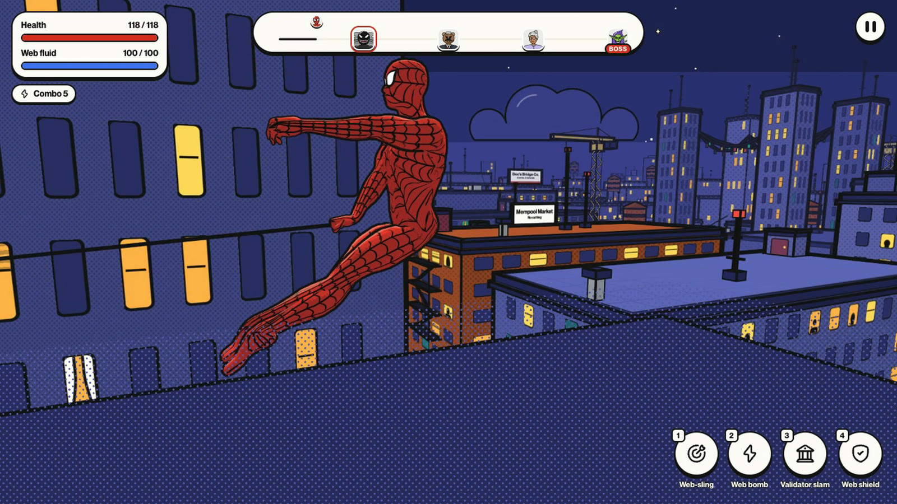
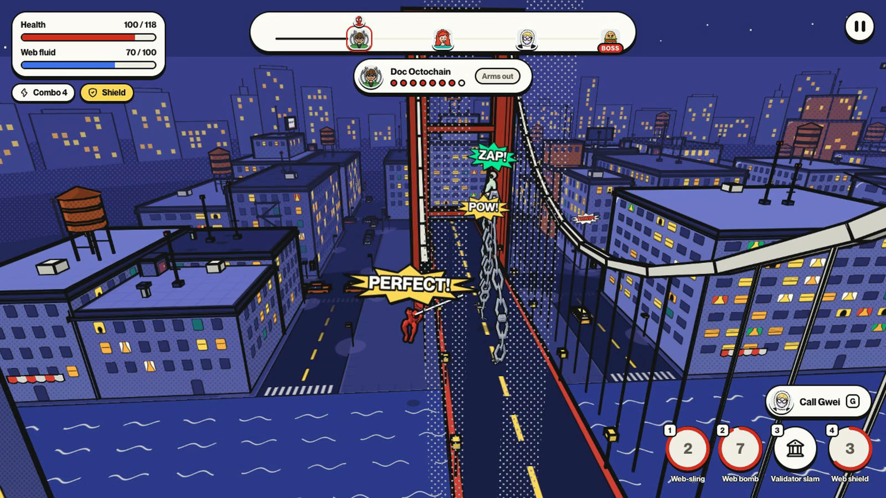
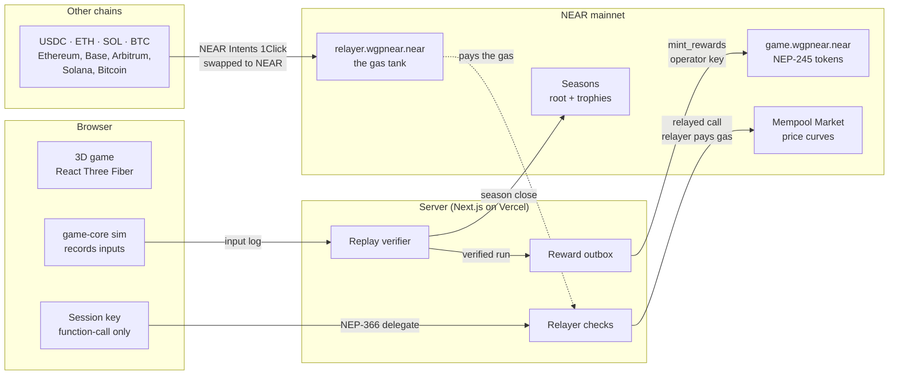

# With Great Power (WGP)

With Great Power is a 3D web-swinging game you play free in a browser: you swing through a comic-book city at night, fight parody villains, run errands for your neighbours and trade what you win with an NPC vendor whose prices move with every trade. **Every ranked score is replayed and verified by the server** before it counts, and anyone can re-run that replay with one command. Everything you earn is a NEP-245 token in one contract on NEAR mainnet, and after a Google sign-in there are no wallet popups, seed phrases or gas prompts: a game-only key in your browser signs your game actions and the game's relayer pays the gas. When that gas runs low, anyone can refill it from Ethereum, Base, Arbitrum, Solana or Bitcoin through NEAR Intents, at [wgponnear.fun/gas](https://www.wgponnear.fun/gas).

[](https://www.wgponnear.fun/play)

**Play:** https://www.wgponnear.fun/play (free, no install). A first visit puts you straight into a night as a guest; sign in to be ranked and to earn on NEAR.

| Where it runs | What | Evidence |
|---|---|---|
| **Live on NEAR mainnet** | The contract [`game.wgpnear.near`](https://nearblocks.io/address/game.wgpnear.near) holds every hero, item, suit, badge and Bit as a NEP-245 token: the standard's core, without its metadata extension. | [`track-nep245`](docs/EVIDENCE.md#track-nep245) |
| **Live on NEAR mainnet** | Gwei Stacy, a vendor inside the contract, prices each item on a curve that moves with every trade. | [`judge-3`](docs/EVIDENCE.md#judge-3) |
| **Live on NEAR mainnet** | Player accounts call the contract themselves. How many, and how few accounts make most of the calls, is under [By the numbers](#by-the-numbers). | [`judge-2`](docs/EVIDENCE.md#judge-2) |
| **Live on NEAR mainnet** | Sandwich Man, an NPC trader, trades from his own account, `sandwich.wgpnear.near`. His fixed rules list the moves the market would accept; an LLM, Kimi K3 (Moonshot), picks one or passes, and the rules pick whenever it can't (no API key on the server, a timeout, an error). Which brain is live is `brain.mode` in `/api/market/npc`. | [`track-agent-npc`](docs/EVIDENCE.md#track-agent-npc) |
| **Live, first refill pending** | The Gas tank at [`/gas`](https://www.wgponnear.fun/gas): anyone can refill `relayer.wgpnear.near`, the account that pays players' gas, from Ethereum, Base, Arbitrum, Solana or Bitcoin through NEAR Intents' 1Click API. Live quotes work today; no real refill has landed on chain yet. | [`track-intents`](docs/EVIDENCE.md#track-intents) |
| **Practice only** | Signed out, `/play/market` is a practice market in your browser, not on NEAR. Investing in the vendor runs only there and in a local checkout. | [`track-invest-practice`](docs/EVIDENCE.md#track-invest-practice) |
| **Simulation only** | `/lab/economy` fast-forwards bot players on the same pricing code. Nothing in it is on chain. | [`track-fast-forward`](docs/EVIDENCE.md#track-fast-forward) |
| **Built, not deployed** | Contract v3 (metadata, enumeration and investing in the vendor) is on the branch `review/contract-v3`, reviewed by a second AI agent that did not write it; not an audit. | [`track-nep245-v3`](docs/EVIDENCE.md#track-nep245-v3) |

Each row links its entry in [docs/EVIDENCE.md](docs/EVIDENCE.md), which names the test or the read-only mainnet check behind it. `pnpm install --frozen-lockfile && pnpm evidence --chain` runs them all and prints one PASS, FAIL or SKIP line per claim. What the evidence does not show, and what to weigh against it (a bot can rank, seeds can be re-rolled, the owner key is a hot key, and Season 1 is a small playtest with airdrops), is under [Limits](#limits-and-whats-next) and [By the numbers](#by-the-numbers).

| | |
|---|---|
| **Contract** | [`game.wgpnear.near`](https://nearblocks.io/address/game.wgpnear.near) on NEAR mainnet |
| **Live numbers** | https://www.wgponnear.fun/stats, or `GET /api/stats` |
| **Track** | NEAR HACKATHON, Nov 1–14, 2026: Games With Real Economies (`games`) |
| **License** | MIT ([LICENSE](LICENSE)) |

**Contents:** [Track fit](#how-it-meets-the-track) · [5-minute check](#for-judges-5-minute-check) · [Numbers](#by-the-numbers) · [Screenshots](#screenshots) · [World](#the-world) · [Game loop](#the-game-loop) · [Economy](#the-economy-loop) · [Ways to play](#ways-to-play) · [Try it](#try-it-do-x-see-y) · [NEAR](#what-near-does-here) · [Verification](#how-verification-works) · [Evidence](#evidence) · [Run locally](#run-it-locally) · [Layout](#layout) · [Limits](#limits-and-whats-next) · [Disclosures](#built-during-the-hackathon)

## How it meets the track

The track's prompt (["Games With Real Economies"](https://github.com/nearai/near-hackathon-prompt-examples/blob/main/tracks/09-games.md)) lists what to build. Each line below says where it is in WGP and how to check it.

| The track asks for | In WGP | Check |
|---|---|---|
| Judged on the game loop, not the token | A real-time 3D action game: swing, fight, climb, race. 8 ways to play; all are built. Duels had no verified run as of Nov 13; `/api/stats` has the count now. | Play a guest night at `/play` (check 1). The order things were written in: a 2D real-time prototype of the night came first (Nov 1, commit `699457d`). The plan for the 3D game, [docs/ARCHITECTURE.md](docs/ARCHITECTURE.md), was committed on Nov 2 (`94c8d19`), three minutes before the first 3D simulation code (`143b12e`). [docs/GAME-LOOP.md](docs/GAME-LOOP.md) was written on Nov 12 and documents the loop as built; it was not a design written before the code. [Evidence](docs/EVIDENCE.md#track-game-loop) |
| Bonus if players never notice the chain | Google sign-in, a game-only session key, a relayer that pays gas. No popup after sign-in. | [Try it](#try-it-do-x-see-y), steps 2, 3 and 5. [Evidence](docs/EVIDENCE.md#track-chain-unnoticed) |
| Items are NEP-245 multi tokens, one contract for every item type | Heroes, suits, loot, Bits, badges and trophies are all token ids in `game.wgpnear.near`. The deployed contract (v2) has NEP-245's core: transfers and batch transfers, balance and supply views, `mt_tokens_for_owner` and the standard's events. It has no metadata extension, no global enumeration (`mt_tokens`) and no approvals. v3 adds metadata, enumeration and merchant investing. It is built, reviewed by a second AI agent that did not write it (not an audit) and rehearsed on a copy of mainnet state, and it is not deployed. Its source is on the branch `review/contract-v3`, not on `main`; the review's findings, test counts and commits are in [docs/CONTRACT-V3-REVIEW.md](docs/CONTRACT-V3-REVIEW.md). | Check 4 (command B). [Evidence](docs/EVIDENCE.md#track-nep245) |
| Social or email login, no seed phrases, popups or gas prompts in the loop | Google through Privy; NEAR wallets also work with one signed message | Step 2. [Evidence](docs/EVIDENCE.md#track-social-login) |
| NEAR Intents (on the track's "lean on" list) | **The Gas tank refills the relayer from 5 chains through NEAR Intents' 1Click API.** Signed-in players never pay gas: `relayer.wgpnear.near` pays it, and when its balance falls under the cut-off, signed-in trades pause. At https://www.wgponnear.fun/gas anyone can refill it with USDC or ETH on Ethereum, Base or Arbitrum, USDC or SOL on Solana, or BTC: a live dry quote, then a one-time deposit address and the swap's status until the NEAR lands. The recipient is always the relayer, fixed on the server; only the curated tokens and $1 to $50 a time are accepted, and a failed swap is refunded on the origin chain. The game's own economy (items and Bits) still lives in one contract and doesn't use Intents. | Tests pin the fixed recipient, the curated tokens, the bounds and 1Click's errors ([`apps/wgp/src/server/intents/one-click.ts`](apps/wgp/src/server/intents/one-click.ts)). The dry quote is a live check against the site. A real refill is owner action needed until one lands on chain. [Evidence](docs/EVIDENCE.md#track-intents) |
| NPCs with wallets | Two, of different kinds. **Live on mainnet:** Gwei Stacy, the vendor. Her stock and her till are NEP-245 balances on chain, held by the contract's own account, `game.wgpnear.near`: she has no account or key of her own. **Live on mainnet since Nov 13, 2026:** Sandwich Man, a trader with a NEAR account of his own, [`sandwich.wgpnear.near`](https://nearblocks.io/address/sandwich.wgpnear.near), which holds his Bits and items and signs his trades (next row). Gwei is rule-based. Sandwich Man's moves are picked by an LLM among the moves his rules allow, or by the rules alone (next row). | Gwei: check 3 (command A) shows each pool's `stock` and `bits`. Sandwich Man: his account and transactions under [Proven on mainnet](#proven-on-mainnet), and [docs/npc-trader.md](docs/npc-trader.md). [Evidence](docs/EVIDENCE.md#track-npc-wallets) |
| Agent NPCs | Sandwich Man, the arbitrageur. **Live on mainnet since Nov 13, 2026: he trades from his own account, [`sandwich.wgpnear.near`](https://nearblocks.io/address/sandwich.wgpnear.near).** **An LLM picks his move; his rules fence it in.** Each turn his fixed rules in one file, [`apps/wgp/src/lib/market/npc-rules.ts`](apps/wgp/src/lib/market/npc-rules.ts), list every move the market would accept inside his caps (flip a cheap listing, buy a dip, undercut Gwei, cash out, clear stock when broke), plus "pass". Kimi K3 (`kimi-k3`, Moonshot's API) picks one and writes his reason in character; the server takes the pick only if it is one of those moves, and the move and its numbers stay the rules' own. With no `LLM_API_KEY` on the server, after a 20-second timeout, on an error or a cut-off answer, or once his 10 LLM calls of the day are used, the rules' first move is taken instead. Each logged move records which brain picked it (`kimi-k3` or `rules`), and `/api/market/npc` reports `brain.mode` (`llm` or `rules`) and the model; `LLM_API_KEY` is set in production (since Nov 15, 2026), so the live mode is `llm`. He uses only the market calls players use, signs them with his own key and pays his own gas. His first trade on chain was a `market_buy` of 2 Sybil goo from Gwei for 72 Bits ([`AcmNAmHr…`](https://nearblocks.io/txns/AcmNAmHr1FDHEzW6YNMFC3ULwnMmGWnyBCyihmk6LVSf)); the market page shows each move with his reason and its transaction. He takes a turn only after real activity (a player's trade or listing, or someone opening the market, at most once every 5 minutes), one action a turn and at most 10 a day. Disclosed: he starts from a one-off seed of 300 Bits minted by the operator, is always labelled NPC, is never counted as a player (`pnpm stats` counts his calls apart from players') and his trades complete nobody's market quest. He also trades in the practice market (in a visitor's browser), the simulated market (a local checkout) and `/lab/economy`. | `curl -s https://www.wgponnear.fun/api/market/npc \| jq '{mode, accountId, bits, brain, log}'`; his transactions under [Proven on mainnet](#proven-on-mainnet); [docs/npc-trader.md](docs/npc-trader.md); `/lab/economy`, **Load a run where he goes broke** (seed 270: he closes shop three times and reopens). [Evidence](docs/EVIDENCE.md#track-agent-npc) |
| Merchant sets prices from stock and demand | A constant-product curve per item: buying raises the price, selling lowers it | [`contracts/wgp/src/market.rs`](contracts/wgp/src/market.rs). [Evidence](docs/EVIDENCE.md#track-merchant-prices) |
| Pricing rules in one readable file | [`apps/wgp/src/lib/market/math.ts`](apps/wgp/src/lib/market/math.ts) mirrors the contract's maths with the same integers and rounding; both test against the same vectors | Read the file's first 15 lines. [Evidence](docs/EVIDENCE.md#track-pricing-file) |
| A merchant's reasoning appears in a tooltip | **Why this price?** on every item in the market: Gwei explains the price from her real stock and till | `/play/market`, press **Why this price?** [Evidence](docs/EVIDENCE.md#track-reasoning-tooltip) |
| A merchant that goes broke stops trading until someone invests in it | **Stops when broke: live on mainnet.** Gwei sells only what she holds and pays only from her till, item by item. With an empty till for an item she stops buying it until a player buys from her; sold out, she stops selling it until a player sells to her. Her shop for that item shows closed, with the reason. **Invest to reopen: practice market and lab only, not on mainnet (v3 is not deployed).** The deployed contract (v2) has no way to invest in her to reopen; investing is in v3, which is not deployed. On mainnet the market says so on a closed shop and sends no investing call. v3's calls are `market_invest`, `market_withdraw` and `market_claim`; the relayer has them on its allow-list and refuses them until the live contract is v3. **Where investing runs today:** the app runs v3's investing rules in the practice market (any guest, in the browser, practice Bits, not on NEAR) and in the simulated market (a local checkout, server-side). There a player funds a broke till, the shop reopens at the same price, they earn half that item's gas fees and can withdraw, and the sheet states what they risk before they confirm. Sandwich Man closes shop under 60 Bits and reopens at 120 by selling what he holds; that is proven in tests and the lab, not yet by a mainnet transaction, and `/api/market/npc` says whether his shop is closed right now. | The rules: `contracts/wgp/src/market.rs` (`buy_cost`, `sell_payout`) and [`apps/wgp/src/lib/market/invest.ts`](apps/wgp/src/lib/market/invest.ts), tested against vectors the v3 Rust printed; her words: `apps/wgp/src/lib/market/reasoning.ts`. Practice: `/play/market` signed out, **Empty Gwei's … till**, then **Invest in Gwei**. Fast-forward: `/lab/economy`, **Drain Gwei, then invest in her**, run 30 days; **Drain Gwei** alone counts the item-days she ended sold out and unable to buy. For him, **Load a run where he goes broke**. What is live where, the maths and the risks: [docs/INVESTING.md](docs/INVESTING.md). [Evidence](docs/EVIDENCE.md#track-merchant-broke) |
| Player-owned markets | Players list items for each other; the contract holds them in escrow | `list_item` and `buy_listing` transactions (command D). [Evidence](docs/EVIDENCE.md#track-player-markets) |
| Economies that evolve without a dev patch | Prices are contract state and move with every trade. No deploy, no cron job. | Command A: prices have moved off their starting values. [Evidence](docs/EVIDENCE.md#track-no-dev-patch) |
| A fast-forward mode | `/lab/economy` runs 60 bot players for 21 days on the same pricing code | Check 7. [Evidence](docs/EVIDENCE.md#track-fast-forward) |

## For judges: 5-minute check

Every check is read-only: no sign-in, no wallet, no transaction. Commands A–E need `curl` and `jq`. F and G need git, Node ≥ 22 and pnpm 10 (`corepack enable`).

Coding agents: [AGENTS.md](AGENTS.md) lists every command with what it should print and how long it takes.

| # | Claim | Do | See | Proof |
|---|---|---|---|---|
| 1 | The game runs in a browser, no install | Open https://www.wgponnear.fun/play, or press **Play now** on the home page. A first visit puts you straight into a night as a ready-made hero, The Node; there is no form first. | A 3D night of four stops (two fights, two errands). It ends on a card saying **Banked. Get some sleep.** with an **Unranked score**. Guest nights stay in your browser and are never ranked. | [Evidence](docs/EVIDENCE.md#judge-1) |
| 2 | The contract is live and used by players | Run command D | Calls from player accounts (`register_hero`, `craft_suit`, `equip_suit`, `market_buy`, `market_sell`, `list_item`, `buy_listing`) and `mint_rewards` from `operator.wgpnear.near`. Calls from `sandwich.wgpnear.near` are the NPC trader's, not a player's. | [Evidence](docs/EVIDENCE.md#judge-2) |
| 3 | The market lives in the contract | Run command A | `{"open":true,"fee_bps":500,"pools":12,"prices_milli":[…]}`. Prices are in thousandths of a Bit. Several have moved off their starting values because players traded. | [Evidence](docs/EVIDENCE.md#judge-3) |
| 4 | Players hold their items on chain | Run command B | A player's NEP-245 tokens: `hero:…`, `item:bits`, loot such as `item:fee-bomb`, a crafted `suit:…`, and soulbound badges such as `trophy:badge:daily-podium` | [Evidence](docs/EVIDENCE.md#judge-4) |
| 5 | The game reads the market from the chain | Run command C | `{"onChain":true,"network":"mainnet","contractId":"game.wgpnear.near",…}` | [Evidence](docs/EVIDENCE.md#judge-5) |
| 6 | Ranked scores are reproducible | Run command F | One `OK` line per run, then `5/5 runs reproduced from https://www.wgponnear.fun.` | [Evidence](docs/EVIDENCE.md#judge-6) |
| 7 | A simulation fast-forwards the economy (not mainnet) | Open https://www.wgponnear.fun/lab/economy, choose **Instant** and press **Run 21 days** | **Day 21 / 21**, the counters (Bits in play, Gwei's till, Bits burned, suits crafted, trades), a price chart per item and Gwei's reasoning for each price. Bot players, not real ones; prices moving on mainnet is check 3. | [Evidence](docs/EVIDENCE.md#judge-7) |
| 8 | The simulation is deterministic | Open https://www.wgponnear.fun/lab/determinism | **✓ All 4 replays match Node**: your browser replays four recorded nights and gets the same state hashes as Node | [Evidence](docs/EVIDENCE.md#judge-8) |
| 9 | The numbers in this README are real | Run command G (30 seconds to two minutes, depending on NearBlocks rate limits), or open https://www.wgponnear.fun/stats | The live counts from the game's database, then the contract's function calls counted by method from NearBlocks, apart from its other receipts | [Evidence](docs/EVIDENCE.md#judge-9) |

```bash
# A. The contract's market (NEAR JSON-RPC, read-only)
curl -s https://rpc.mainnet.near.org -H 'Content-Type: application/json' \
  -d '{"jsonrpc":"2.0","id":1,"method":"query","params":{"request_type":"call_function","finality":"final","account_id":"game.wgpnear.near","method_name":"market_state","args_base64":"e30="}}' \
  | jq -r '.result.result | implode' | jq -c '{open: .params.open, fee_bps: .params.fee_bps, pools: (.pools | length), prices_milli}'

# B. A player's tokens. 9a_z53.wgpnear.near is a Google player whose account the game's factory created.
#    (Not the author's account, which is sele.wgpnear.near. Any account from command D works here.)
curl -s https://rpc.mainnet.near.org -H 'Content-Type: application/json' \
  -d "{\"jsonrpc\":\"2.0\",\"id\":1,\"method\":\"query\",\"params\":{\"request_type\":\"call_function\",\"finality\":\"final\",\"account_id\":\"game.wgpnear.near\",\"method_name\":\"get_player\",\"args_base64\":\"$(printf '%s' '{"account_id":"9a_z53.wgpnear.near"}' | base64)\"}}" \
  | jq -r '.result.result | implode' | jq -c '{level, reward_nonce, tokens}'
# → {"level":21,"reward_nonce":45,"tokens":[["hero:9a_z53.wgpnear.near","1"],["suit:mint","1"],["item:bits","4839"],["item:fee-bomb","27"],["suit:stealth","1"],["trophy:badge:daily-podium","1"],…]}  (as of Nov 13; it changes as they play)

# C. The live game's view of the market
curl -s https://www.wgponnear.fun/api/market | jq -c '{onChain, network, contractId, till}'

# D. The contract's latest transactions (NearBlocks API)
curl -s 'https://api.nearblocks.io/v1/account/game.wgpnear.near/txns?per_page=25' \
  | jq -r '.txns[] | "\(.transaction_hash)  \(.predecessor_account_id)  \([.actions[]? | .method // .action] | join(","))"'

# E. One relayed session-key trade's events: mt_transfer, mt_burn of the fee, market_trade.
#    A market_buy by the player azalleaxyz.wgpnear.near on Nov 12. An archival NEAR RPC is used because regular nodes drop older transactions.
curl -s https://archival-rpc.mainnet.fastnear.com -H 'Content-Type: application/json' \
  -d '{"jsonrpc":"2.0","id":1,"method":"tx","params":{"tx_hash":"GJXrKe2oNjbTvxG2HyMt4DeTBXNPxGVRBbXsUrzv2TPJ","sender_account_id":"relayer.wgpnear.near","wait_until":"FINAL"}}' \
  | jq -r '.result.receipts_outcome[].outcome.logs[]'

# F. Replay the All-time top 5 yourself (downloads each run's seed, start save and input log)
git clone https://github.com/71Labs/WithGreatPower && cd WithGreatPower
pnpm install --frozen-lockfile
pnpm verify

# G. The live numbers, and the contract's transactions counted from NearBlocks
pnpm stats            # site only: curl -s https://www.wgponnear.fun/api/stats | jq   ·   chain only: pnpm stats --chain-only
```

Command F printed this from a fresh clone on Nov 12. The board moves, so your five runs may differ; each line must still say `OK`:

```
OK    46ffe6cf azalleaxyz: score 15995 vs 15995, ticks 4237 vs 4237, hash 183a3432 vs 183a3432
OK    ec0e4777 9a_z53: score 12890 vs 12890, ticks 3645 vs 3645, hash ad9435eb vs ad9435eb
OK    a255f138 ambactamwkwk: score 7880 vs 7880, ticks 4795 vs 4795, hash 2636c9bd vs 2636c9bd
OK    8f9855e7 nasibabalili7: score 7590 vs 7590, ticks 3290 vs 3290, hash e4341dda vs e4341dda
OK    10864077 hossinshabani1389: score 7235 vs 7235, ticks 5608 vs 5608, hash 666c4d9f vs 666c4d9f
5/5 runs reproduced from https://www.wgponnear.fun.
```

A `SKIP` line marks a run played under an older ruleset. To replay one, check out the tag the note names (`git checkout ruleset-v3` or `ruleset-v2`, then `pnpm install --frozen-lockfile`) and pass the full run id from `GET /api/leaderboard?board=alltime`: `pnpm verify <runId>`.

## By the numbers

**Season 1 (Nov 5–14) is a playtest season, and play in it was incentivised.** During it the team offered players daily airdrops, sent by hand through Uprail, outside the game (the game itself never pays and its copy promises no money). Read the counts below as a small, incentivised playtest, not organic demand.

Day by day, the same chain data shows who came back and how concentrated the calls are: [docs/TRACTION.md](docs/TRACTION.md) has the tables by UTC day, with retention and the relayer outage marked, and the author's accounts and Sandwich Man left out. `pnpm traction` re-runs it.

Real players, counted two ways. The first is the public chain, which anyone can recount. The second is the game's own database, served by a public endpoint: those figures can be re-read but not checked independently. The chain counts are as of Nov 13, 2026, 11:56 UTC and the game's as of Nov 13, 2026, 11:54 UTC. Both only grow; `pnpm stats` prints the current ones. The player accounts include the author's own, `sele.wgpnear.near`, and most of the activity comes from a few accounts: the first table gives the split, and `pnpm stats` derives every figure in it. The author also plays from a NEAR wallet account, `sele71.near` (9th on the All-time board on Nov 14). It has never called a game method itself, only received reward mints, so it is in the game's counts and not in the chain's player count. `pnpm evidence --chain` reads the numbers from the two tables below and fails if a live count is below one of them. [Evidence](docs/EVIDENCE.md#by-the-numbers)

**On NEAR mainnet** (counted from NearBlocks; re-run `pnpm stats`, 30 seconds to two minutes, depending on NearBlocks rate limits):

| | |
|---|---|
| Function calls to `game.wgpnear.near` | 242 (1 of them failed) |
| Other receipts NearBlocks lists for the contract's account (transfers, refunds, its creation; not calls) | 4 (1 of them failed) |
| Player accounts that called a game method themselves (the author's `sele.wgpnear.near` is one; Sandwich Man is not) | 18 |
| Of those accounts, the ones that made more than one call | 6, so 12 made exactly one |
| Market calls by players, and the accounts that made them | 27 calls from 4 accounts: 21 from the two busiest, 1 from the author's |
| `mint_rewards` (verified nights' loot, Bits and badges; one is Sandwich Man's seed) | 169 |
| `register_hero` | 19 |
| `craft_suit` / `equip_suit` | 16 / 7 |
| Market: `market_buy`, `market_sell`, `list_item`, `buy_listing` | 11, 5, 7, 4 |
| Of those, calls by Sandwich Man, the NPC trader (counted apart; not a player) | 1, a `market_buy` |

**In the game** (database-only figures, from [`/api/stats`](https://www.wgponnear.fun/api/stats)):

| | |
|---|---|
| Matches started / finished and verified | 270 / 240 |
| Runs rejected by the verifier | 0 |
| Free-roam City outings | 298, with 19 side tasks finished |
| Heroes: signed-in players who have started a match (`players.played`, the count the landing page shows) | 26 (24 have a verified match; 27 have signed up, `players.total`) |
| Verified play time | 6.4 hours |
| Verified matches by mode | Ranked nights 136 · Daily Run 64 · Case files 25 · Time trials 15 · Duels 0 |
| Reward mints queued / sent to the contract | 178 / 178 |
| Invites | 8 friends invited, 4 count, 1 Recruiter badge earned |

## Screenshots

| | |
|---|---|
| <br>**Swing** across a comic-book city, then land and fight. | <br>**Boss fights**: Doc Octochain holds the bridge. |
| <br>**Tonight**: the hub for nights, cases, races, the City and invites. | <br>**The City**: free roam with climbing, wall-runs, traffic and six side tasks. |
| <br>**Verified · Ranked**: the server replays the night before it counts. | <br>**Leaderboards**: Tonight, Season and All time. |
| <br>**Mempool Market**: an NPC vendor whose prices move with every trade. | <br>**Economy lab**: 21 days of bot trading on the real pricing code. |
| <br>**Case files**: three story chapters, each with a soulbound badge. | <br>**Compete**: the Daily Run, time trials and ghost duels. |
| <br>**Sign in** with Google or a NEAR wallet. | <br>**Real bodies**: MakeHuman characters with motion capture. |

## The world

The city runs on "mainnet", and its villains are a market's oldest tricks given faces: Sandwich Man cuts into every queue from the front and the back, Gas Goblin spikes the fees, Doc Octochain tolls the bridges, and the Sybil votes as thousands of himself. The season's thief, the Right-Clicker, right-click-saves people into flat copies. Gwei Stacy, the vendor, counts everything in gwei. The hero's job is to keep the city's market honest. The canon is in [docs/story/bible.md](docs/story/bible.md).

## The problem

Web3 games make players fight wallets before villains: seed phrases, a popup for every action, gas prompts mid-game. Their leaderboards trust whatever score the browser sends, and their economies are a token chart with a game attached.

WGP is built the other way round:
- **The game comes first.** It's a full 3D action game you can finish a night of as a guest, with no account.
- **The chain stays out of the loop.** A player signs in once. After that a game-only key signs their game actions and our relayer pays the gas.
- **Scores are reproducible, not claimed.** The server replays each ranked night's inputs through the same deterministic simulation the browser ran, and ranks only what reproduces. Anyone can re-run that check.
- **The economy is play.** Loot comes from the villains you beat, suits need specific loot, and the vendor's prices are set by what players buy and sell. Suits are cosmetic: a suit changes how the hero looks, not how they fight.

## The game loop

The full design is in [docs/GAME-LOOP.md](docs/GAME-LOOP.md). In short:

| Every | The player | The economy |
|---|---|---|
| **Few seconds** | Swings, lands, climbs, dodges, punches, fires a power | Gold Bits tokens and boost rings on the route |
| **1 to 2 minutes** | Finishes a night of four stops; the server replays and ranks it | Loot and Bits are minted to their NEAR account in the background |
| **Session** | Plays a few nights, trades with Gwei, lists items, crafts a suit, climbs the boards | Prices move with each trade, a gas fee on each trade is burned (5% today), recipes burn loot |

A night is short, and the figure is measured, not planned: the three recorded nights in this repository that clear all four stops replay in 63, 67 and 81 seconds of game time, and on the live site verified play time divided by verified runs (all modes together) is about a minute and a half. `pnpm evidence --chain` fails if that live figure leaves the range of 45 seconds to 3 minutes.

## The economy loop

[Evidence](docs/EVIDENCE.md#the-economy-loop) for each step.

1. **Earn.** Each verified night mints loot from the villains you caught, plus Bits: `floor(score / 100) + 5`, +25 on a level-up, +1 for each gold Bits token you swing through (up to 25), and at most 1,000 a night. A hero who already holds over 150 Bits gets less, down to the 5 for showing up at 400: a taper on the payout that changes no score.
2. **Trade.** Gwei Stacy, an NPC vendor whose stock and till the contract holds, prices each item on a constant-product curve. Buying raises her price and selling lowers it. Players can also list items for each other, at 50–400% of her price.
3. **Burn.** A "gas fee" on every trade is burned: the contract's `fee_bps`, 5% today. Crafting a suit (`/play/suits`) burns the loot in its recipe, and the contract's `craft_bits` on top (250 today). The app reads both live: when the owner changes them, the market's quotes and the Suit lab's "Costs N Bits" follow without a deploy.
4. **Nobody sets prices.** A price is wherever supply and demand leave the curve. Gwei explains each one (**Why this price?**), sells only what she holds and pays only from her till.

**Gwei's wanted list: the market decides what you hunt.** Each UTC day Gwei posts up to three items she is short on: sold out, down to 75% of her opening stock, or priced at least 25% above where she opened. The first request of the day works the list out from her pools and stores it with the snapshot it came from, so the day's list doesn't change. A verified night that brings in a wanted item gets a multiplier on that item's drop (×2, or ×3 when she is sold out), capped per night and per player per day by rarity; the score, the replay and the Bits are unchanged. Tonight (`/play`) shows the list and the night's results show the bonus; selling her the extra refills her stock and brings the price back down. The rules are in [`apps/wgp/src/lib/market/wanted.ts`](apps/wgp/src/lib/market/wanted.ts).

The curve, in [`apps/wgp/src/lib/market/math.ts`](apps/wgp/src/lib/market/math.ts) and [`contracts/wgp/src/market.rs`](contracts/wgp/src/market.rs):

```
x = virtual_items + stock        y = virtual_bits + bits        spot price = y / x Bits
buy n:   ceil(y·n / (x − n))     only from her stock
sell n:  floor(y·n / (x + n))    only from her till
fee:     ceil(bits · 500 / 10000), burned
```

A round trip never profits, because a buy rounds up and a sell rounds down.

## Ways to play

Every mode's runs are replayed by the server. The right-hand column is what each puts on NEAR. In a fresh browser, start at https://www.wgponnear.fun/play: it makes you a guest hero first. The paths in brackets open a mode once you have one (after step 1 of [Try it](#try-it-do-x-see-y), in the same browser). [Evidence](docs/EVIDENCE.md#ways-to-play)

| Mode | What it is | On NEAR |
|---|---|---|
| **Ranked nights** (`/play/patrol`) | Patrol the city: two villain fights and two errands | `item:bits` and loot for each verified night |
| **Daily Run** (`/play/compete`) | The same city for everyone, new each UTC day, 3 tries | `trophy:badge:daily-podium` for the day's top 3, `daily-winner` for first |
| **Time trials** | Five courses with medal times | Nothing: verified boards only |
| **Duels** | Race the ghost of any player's verified run. Built and tested. The count of verified duels is `runs.byMode.duel` in `/api/stats`; it was 0 on Nov 13. | Nothing: ghosts are real replays |
| **Case files** (`/play/cases`) | Three story chapters: Missing: Mary Jpeg, The Sybil Vote, Fee Strike | `trophy:badge:case-00N` on your first verified clear |
| **The City** (`/play/city`) | Free roam: run, sprint, climb, wall-run, swing, dodge traffic, six side tasks | Nothing: XP, saved with your hero |
| **Invite 3 friends** (`/play/invite`) | Friends who add their X and play a verified night count | `trophy:badge:recruiter` |
| **Season 1** (Nov 5–14) | Nightly bests add up on the Season board | At the close: the final board's root and digest, recorded once, and `trophy:s1:1…10` for the top 10. Season 1 ends Nov 15, 00:00 UTC (the end of Nov 14); after that the record is `get_season("s1")` on the contract and the results file is `/api/seasons/s1/results` (the status table says what to expect before and after). |

Design docs: [chapters](docs/chapters/) · [the story bible](docs/story/bible.md) · [competitive modes](docs/compete.md) · [referrals](docs/referrals.md).

## Try it: do X, see Y

All steps work on the live site, with no install.

1. **Play a night as a guest.**
   - **Do:** open https://www.wgponnear.fun and press **Play now**, or open https://www.wgponnear.fun/play. A first visit goes straight into a night with a ready-made hero, The Node, in the Classic suit with three starter powers; there is no form first. For every night after that, press **Swing out** on Tonight (`/play`). **Make it yours**, also on Tonight, renames the hero and picks a starter suit. A signed-in player with no hero yet chooses a name, a suit and three powers first (`/play/bitten`, **Get bitten**).
   - **Controls:**
     - WASD or the arrow keys run relative to the camera. Let go and the hero stops.
     - Space or the mouse shoots a web toward where you're steering. Hold it to swing and chain webs; let go to fly.
     - 1–4 fire powers, G calls Gwei, M opens the city map, and Esc or P pauses (How to play is in the pause menu). Click into the game for mouse look.
     - On touch: the left stick steers, a finger anywhere else looks around, and the right side webs.
   - **See:** a 3D night of four stops. Gold Bits tokens and boost rings line each route. The night ends on **Banked. Get some sleep.**, with an **Unranked score**, stop-by-stop results and your loot.
   - **Classic mode:** the **Classic mode** link under **Swing out** opens `/play/classic`, which plays the same night turn by turn: the same four stops, from the same seed. It's unranked.
2. **Sign in with Google or a NEAR wallet.**
   - **Do:** open the **Sign in** chip at the top of any game screen, then choose one:
     - **Continue with Google:** Privy logs you in with Google and gives you a NEAR key, with no seed phrase or extension. A new player picks a name, and the game's factory account `wgpnear.near` creates `<name>.wgpnear.near` holding that key plus a game-only session key.
     - **Use a NEAR wallet:** pick a wallet and sign one message (NEP-413). It's not a transaction and costs no gas.
   - **See:** the chip shows your handle. Your save now lives on the server.
3. **Play a ranked night.**
   - **Do:** finish a night while signed in.
   - **See:**
     - the results show **Verified** and **Ranked**, **Score, from the server**, your rank on Tonight's board and **You earned N Bits**;
     - the night's loot and Bits are minted to your NEAR account in the background, with nothing for you to sign. They show up in `get_player` (command B) and on NearBlocks as `mint_rewards` from `operator.wgpnear.near`;
     - https://www.wgponnear.fun/play/leaderboard lists you on the Tonight, Season and All-time boards.
4. **Verify any ranked run yourself.**
   ```bash
   pnpm install --frozen-lockfile
   pnpm verify                    # the All-time top 5
   pnpm verify <runId>            # one run: the full id from GET /api/leaderboard
   pnpm verify --board tonight    # Tonight's board (also --top N, --base <url>)
   ```
   - **See:** `OK <run> <player>: score … vs …, ticks … vs …, hash … vs …` for each run and `N/N runs reproduced`. The script downloads the run's seed, start save and input log from `GET /api/runs/<id>/replay` and replays it locally with `@wgp/game-core`. It exits non-zero if any run doesn't reproduce.
5. **Trade in the Mempool Market.**
   - **Do:** open https://www.wgponnear.fun/play/market.
   - **See, signed out (a guest): the practice market.** It runs in your browser and is not on NEAR.
     - a gold banner, **Practice market: not on NEAR. Sign in to trade for real.**, **Your practice Bits** (300 to start), prices that started from the live market's, and a link, **See the real market on NEAR mainnet: game.wgpnear.near**;
     - on every item, **Why this price?** (Gwei's reasoning, from the practice copy of her stock and till), **Buy**, **Sell** and **Invest in Gwei**. All four work for a guest, with practice Bits;
     - **Empty Gwei's … till** stages a broke shop. **Invest in Gwei** reopens it, and **Withdraw or claim** takes the stake out again 30 seconds later;
     - nothing here is a transaction, changes your saved hero or can be minted.
   - **See, signed in: the real market.**
     - **On NEAR mainnet · game.wgpnear.near**, Gwei's till, and each item's price, 24-hour change, stock and how many you hold;
     - **Why this price?** on any item: Gwei's reasoning from her real stock and till;
     - **Buy** and **Sell** move the price along the curve, and you can list items for other players. There is no investing here until contract v3;
     - each trade is a `market_buy`, `market_sell`, `list_item` or `buy_listing` call from your own account. It's signed by your session key, sent by `relayer.wgpnear.near` as a NEP-366 meta-transaction, and attaches no deposit. Google players get the session key at sign-up; wallet players press **Enable quick play** once.
   - **Is it on chain?** `GET /api/market` says `onChain: true` when the contract's market is live, as it is in production. Without NEAR settings (a local checkout), the same engine runs in simulation and says `onChain: false`.
6. **Watch the economy move.**
   - **Do:** open https://www.wgponnear.fun/lab/economy, choose a speed (1×, 4×, 16× or Instant) and press **Run 21 days**.
   - **See:** 60 bot players patrol, buy, sell, list and craft for 21 days on the same pricing code, with mainnet's settings (5% gas fee, crafting burns 250 Bits, nights tapered by the Bits a hero holds) and the contract's rule that a hero crafts each suit once. The page shows Bits earned against Bits burned, each item's price and Gwei's stock by day, her reasoning, and the Bits in play, burned and crafted. The same seed always gives the same run.
   - **The inflation, and the fix:** the default run earns 58,859 Bits and burns 26,454 of them, about 45%. Tick **Run the old settings** (2% gas fee, crafting burns no Bits, no taper) and run again: 99,022 earned and 2,847 burned, about 3%. [docs/ECONOMY.md](docs/ECONOMY.md) has the measurements, the owner's command and what stays unfixed.
   - **Gwei's limits:** press **Drain Gwei** and run 30 days. A crowd of hoarders and dumpers leaves her sold out of rares and unable to buy the rest, and the page counts the item-days.
7. **Roam the City.**
   - **Do:** after step 1, in the same browser, open the **City** tab or https://www.wgponnear.fun/play/city (it needs a hero). Shift sprints, F webs while held, Q zips, E talks or interacts, M opens the map.
   - **See:** a free-roam city where walls are climbable, barriers and cars are solid (a car at speed knocks you down), and six people have tasks, such as racing Sandwich Man over the roofs with Gwei's order, or unplugging Doc Octochain's relays from the city's highest points.
8. **Open a case file, race the Daily, invite a friend.**
   - **Do:** after step 1, in the same browser: `/play/cases`, `/play/compete`, `/play/invite`.
   - **See:** three story chapters with their own rules and bosses; today's Daily Run with other players' ghosts; your invite link and its 0/3 progress (signed in).
9. **Check it on NEAR.**
   - **Do:** open https://nearblocks.io/address/game.wgpnear.near.
   - **See:** the contract's NEP-245 `mt_mint`, `mt_transfer` and `mt_burn` events, and calls from player accounts.
10. **Look into the gas tank (read-only).**
   - **Do:** open https://www.wgponnear.fun/gas, pick a token, type an amount and your own address on that chain as the refund address (1Click refuses burn addresses). Stop before **Get deposit address**.
   - **See:** the relayer's available NEAR against its cut-off, and a live dry quote from NEAR Intents: "≈ X NEAR reaches the gas tank". A dry quote moves no funds.

## What NEAR does here

[Evidence](docs/EVIDENCE.md#what-near-does-here) for each row of the table below.



| Piece | How |
|---|---|
| **Player accounts** | A wallet player is their own NEAR account. A Google player gets a NEAR key from Privy's embedded wallet, and the game's factory account (`wgpnear.near`) creates `<name>.wgpnear.near` holding that key and a function-call session key for `game.wgpnear.near` only. |
| **Items, suits, trophies and Bits** | NEP-245 multi-tokens in one contract, `game.wgpnear.near` (`contracts/wgp`): the standard's core transfers, balance views, `mt_tokens_for_owner` and events. The deployed v2 has no metadata extension, no `mt_tokens` enumeration and no approvals; v3 adds the first two and is not deployed. Heroes and trophies are soulbound. Transfers need 1 yoctoNEAR and a function-call key can't attach a deposit, so a game key can't transfer a token out of a player's account. It can still trade with it, within the market's caps (see the Mempool Market row). |
| **Rewards** | Each verified night queues a reward mint in the same database transaction. The operator account sends `mint_rewards` in batches of up to 20, each with a per-account nonce, so a retry never mints twice. Mints are sent in the background of player requests, and nothing is scheduled: `vercel.json` has no `crons` entry and no workflow runs on a schedule. Three bearer-protected routes, `/api/cron/mint`, `/api/cron/sweep` and `/api/cron/market-snapshot`, are manual fallbacks for the owner; in this repository only the local sandbox end-to-end script calls one. |
| **The Mempool Market** | An in-contract NPC vendor with a curve per item, player listings held in escrow, and a 5% fee that's burned. **What a stolen game key could do.** It is a function-call key for `game.wgpnear.near` only, and it can't attach a deposit. So it can call the game's deposit-free methods as the player: buy from and sell to Gwei, list the player's items, buy and cancel listings, craft and equip. It can't transfer a token, call an owner or operator method, or call any other contract. A thief therefore can't send a player's tokens to themselves, but could trade them badly, for example list an item at the lowest allowed price for an accomplice to buy. The contract's guards bound that: listing prices within 50–400% of the vendor's, at most 20 items a call, 3 open listings, and per day 40 vendor trades, 10 listings and 10 fills worth 3,000 Bits. The relayer carries a key's calls only for the signed-in player it belongs to, while the server holds that key as live. Used directly instead, the key pays gas from the account's own NEAR, up to a 0.05 NEAR allowance, and a factory-made account starts with none. |
| **No popups in play** | After sign-in, players hold a game-only function-call key. Our relayer submits their signed actions as NEP-366 meta-transactions and pays the gas. `/api/relay/meta` accepts exactly one function call to an allowlisted method, with zero deposit, at most 30 Tgas and within budgets. |
| **Sign-in** | NEAR wallets go through near-connect with a NEP-413 signed message. Google goes through Privy: the server verifies Privy's access token and reads the player's verified email and NEAR key from Privy's API. |
| **Seasons** | The first player request after a season's end, plus 50 minutes for runs in flight, closes it once. The final standings are frozen with their Merkle root, and `record_season` (root, results digest, top 10) is queued. The contract stores it for good and mints a soulbound `trophy:<season>:<rank>` to each of the top 10. The results file, with every leaf's proof, is at `/api/seasons/<id>/results`. |
| **Gas tank (NEAR Intents)** | `/gas` asks NEAR Intents' 1Click API for a quote that turns a deposit on Ethereum, Base, Arbitrum, Solana or Bitcoin into NEAR delivered to `relayer.wgpnear.near`, the account that pays players' gas. The server sets the recipient: a recipient sent by the browser is ignored, and a quote that names anyone else is refused. It takes only 9 listed tokens worth $1–$50, quotes dry until the giver asks for a deposit address, rate-limits deposit addresses per IP, and polls 1Click for the status. 1Click takes a 0.2% fee. Deliveries arrive as wNEAR on `wrap.near`, where the relayer is registered; the owner unwraps them into its balance with one call ([docs/SUSTAINABILITY.md](docs/SUSTAINABILITY.md)). Code: `apps/wgp/src/server/intents/one-click.ts`. |
| **Safe upgrades** | near-sdk's `Promise` links host functions mainnet doesn't have yet, which failed our first deploy. `upgrade` uses low-level `env::promise_*` calls, and `scripts/near/check-wasm-imports.mjs` refuses a wasm that imports them. |

### Status on mainnet (checked Nov 13, 2026)

| | |
|---|---|
| **Used by players on mainnet** (transactions below) | The contract and its market (12 pools, 5% fee); reward mints, Bits and badges included; player accounts created by the factory with session keys; `register_hero`, `craft_suit` and `equip_suit`; `market_buy`, `market_sell`, `list_item` and `buy_listing`, all signed by session keys and relayed (NEP-366) |
| **NPC trader on mainnet** (since Nov 13, 2026) | Sandwich Man trades from his own account, `sandwich.wgpnear.near`, and is never counted as a player. An LLM (Kimi K3) picks among the moves his fixed rules allow when the server has its API key; without it, the rules pick. The owner created the account with 0.3 NEAR and the operator seeded it once with 300 Bits; his first trade landed the same day (transactions below). |
| **The season record: first run on mainnet when Season 1 closes** | `record_season` and its trophies. Season 1 ends Nov 15, 00:00 UTC; runs started before then still count. The first player request after 00:50 UTC on Nov 15 freezes the board and queues the record. **Before the record lands,** `get_season("s1")` answers `null`, no `trophy:s1:*` exists, and `/api/seasons/s1/results` is a 404 until the freeze; the proof is the contract's unit tests and the server's season tests, not a mainnet transaction. **After it lands,** `get_season("s1")` holds the root, the digest and the top of the board, each of those accounts holds `trophy:s1:<rank>`, and the sha256 of `/api/seasons/s1/results` is that digest. `pnpm evidence --chain` checks whichever of these it finds, in full. |
| **Live off chain** | The game and all its modes, runs verified by replay, the boards, Google sign-in (Privy), NEAR wallet sign-in (NEP-413), referrals, classic mode and the soundtrack |
| **Simulation only** | `/lab/economy`, which fast-forwards bot players on the same pricing code |
| **Built, not deployed** | Contract v3: NEP-245 metadata and enumeration, and investing in the merchant. Branch `review/contract-v3`; its review (by a second AI agent that did not write it; not an audit) is summarised in [docs/CONTRACT-V3-REVIEW.md](docs/CONTRACT-V3-REVIEW.md). |
| **Waiting on approval** | NEAR Auth as a second Google sign-in path (its mainnet client). NEAR issued the mainnet client on Nov 14, but its allowed callback URLs don't include the site yet: `login.auth.near.org` answers "Callback URL mismatch" for every address of wgponnear.fun. The flow is built (`apps/wgp/src/lib/near/near-auth.ts`, `/api/auth/near-auth`, `/api/relay/fast-auth` and the test bench at `/lab/near-auth`) and stays off until NEAR adds the site; then it needs one setting, `NEXT_PUBLIC_NEAR_AUTH_CLIENT_ID`, and a deploy. |
| **Live on NEAR mainnet** (since Nov 15, 2026) | Gwei's new stock: four items earned from the Daily Run and from cases (gas receipt, finality flag, evidence bag, torn seed phrase) and two suits that burn them (Notary, Finality). The owner registered them with `set_rules` and opened their pools with `set_market_params` (the arguments are in `docs/economy/new-stock-calls.json`), so the market has 12 pools. The server awards an item only while its pool exists on chain, because `mint_rewards` refuses an item the contract doesn't know |
| **Live, first refill pending** | The Gas tank's first real refill through NEAR Intents: the page and its dry quotes are live, and no real refill has landed on chain yet |

### Proven on mainnet

`pnpm evidence --chain` looks up each of these transactions and checks what it did. The player transactions are from five different players' accounts, named in each row. None is from the author's own account, `sele.wgpnear.near`. [Evidence](docs/EVIDENCE.md#proven-on-mainnet)

| What | Transaction |
|---|---|
| Deploy and `new` (code hash `68F7NhEjUtKweyLU7WNvT183apacLQegfB1DXUoQ2hjJ`, owner `wgpnear.near`, operator `operator.wgpnear.near`) | [`8nyXGMNu…`](https://nearblocks.io/txns/8nyXGMNuFmQkvwJyC9PZv1JVM54Go45QZ69HXXppC1JR) |
| `set_market_params`: opens the market and mints Gwei's stock and till | [`FdQxVNyz…`](https://nearblocks.io/txns/FdQxVNyziV7ioNWPAfL9yAWJ8u2wDN3kRKpEX4JSVcCR) |
| The factory creates a Google player's account, `9a_z53.wgpnear.near`, with their Privy key and a session key | [`DFF1SsPj…`](https://nearblocks.io/txns/DFF1SsPjKPto6Kxa3TfpdX2pSMNC9GftnbJuz9PRWcV8) |
| `mint_rewards` from the operator (one of 169 as of Nov 13) | [`CsnUWQDW…`](https://nearblocks.io/txns/CsnUWQDWSXGwNaapB9iFGH3idEqzQWGbWmrH7pbJegZh) |
| A wallet player's `register_hero` (`cybwithflourish.near`) | [`7dnP8eU7…`](https://nearblocks.io/txns/7dnP8eU7W8b9LdQeZztnttzai5uUc7gHAea4hEeoXnnq) |
| A player's `craft_suit` of the Stealth suit, burning the 3 Sybil goo in its recipe (`9a_z53.wgpnear.near`) | [`3ttQYUBr…`](https://nearblocks.io/txns/3ttQYUBrA8CbKu1s7VuvNA8QAxMMfHsTJGHrKi4AZqjc) |
| A player's `equip_suit` (`nasibabalili7.wgpnear.near`) | [`C2WwQsHy…`](https://nearblocks.io/txns/C2WwQsHyHNBZLrkN1JaVDGZuuf9aYaBJGqvyMSLvRvRp) |
| A `market_buy` from Gwei, with the fee burned (`9a_z53.wgpnear.near`; command E is another, by `azalleaxyz.wgpnear.near`) | [`ASmRJdKZ…`](https://nearblocks.io/txns/ASmRJdKZy3fMPAPNNogcABL4Wdr7CiPPasAxRjXr5xRq) |
| A `market_sell` to Gwei (`azalleaxyz.wgpnear.near`) | [`GDATLg4Q…`](https://nearblocks.io/txns/GDATLg4Qr2cqQZ9S5uaRwZJTup4Y54P7uPyzJzFGaqXE) |
| A player `list_item`, escrowed in the contract (`hossinshabani1389.wgpnear.near`) | [`GhK2jtPK…`](https://nearblocks.io/txns/GhK2jtPKtNpHgjcn93eYRiFjF72mcMcFzbfHqYbnM9tx) |
| A `buy_listing` of another player's listing: a player-to-player trade (`9a_z53.wgpnear.near`) | [`Heu9ZTQv…`](https://nearblocks.io/txns/Heu9ZTQvWmriDngtPQ37defMDZMJSecgBNpdAuLnMdu9) |
| Sandwich Man's account, `sandwich.wgpnear.near`: created by `wgpnear.near` with 0.3 NEAR and one full-access key (Nov 13) | [`Hx32N4dy…`](https://nearblocks.io/txns/Hx32N4dymGnQXUoD1cY36w3kekY2WqKbfvLpvd84W4rm) |
| His one-off seed: a `mint_rewards` of 300 Bits from the operator, with the digest `sha256("npc-seed:sandwich.wgpnear.near:v1")` | [`Hjvobzmd…`](https://nearblocks.io/txns/HjvobzmddfFdFeKoifAZP9wf1YMSEA6qkqpBRC5kFPG7) |
| His first trade: a `market_buy` of 2 Sybil goo from Gwei for 72 Bits, 2 of them the burned fee, signed by his own key and not relayed | [`AcmNAmHr…`](https://nearblocks.io/txns/AcmNAmHr1FDHEzW6YNMFC3ULwnMmGWnyBCyihmk6LVSf) |

**From this source to the deployed code.** The code hash above is the base58 form of the deployed wasm's sha256, `4c25745400717004ab5c18521bf6454a21c6f093d6deff353f8784dcd15df84d`. Building `contracts/wgp` from `main` with `cargo near build non-reproducible-wasm --locked` gives that sha256 on the author's machine. On another machine it gives a different one, because the wasm embeds the builder's absolute cargo registry paths; a reproducible (container) build is not set up. So the link from this source to the deployed code rests on the author's build, and the contract's tests prove the source, not the bytes on chain.

## How verification works

[Evidence](docs/EVIDENCE.md#how-verification-works) for each step.

1. **One simulation.** `packages/game-core` is a deterministic simulation: a 60 Hz fixed step, trig-free maths (polynomial sin, cos and atan2 in `packages/game-core/src/sim3d/dmath.ts`), and integer HP and score. The browser and the server share it. A test scans it for sources of non-determinism.
2. **Recording.** The browser records only inputs: a stick direction, a magnitude, web held, and one-shot powers. They're run-length encoded, usually 1–5 KB a night; the server refuses a log over 64 KB.
3. **Starting a run.** `POST /api/runs/start` issues a server-signed seed. A player has at most one active run and 20 ranked runs a day.
4. **Verifying.** `POST /api/runs/<id>/submit` replays the log from that seed and the server's copy of the save. It checks the ruleset, at least 20 seconds of game time, game time within wall-clock time plus 5 seconds, and that the browser's final state hash matches. Then it ranks the server's score, not the client's.
5. **Rulesets are pinned.** Season 1 plays on ruleset 4. Each mode has its own ruleset tag (cases, trials, the City), so a log from one mode never replays as another. Recorded golden runs must replay byte-identical before a change ships.
6. **Anyone can re-check.** Every verified run's replay is public at `GET /api/runs/<id>/replay` (`seed`, `startSave`, `log`, `score`, `ticks`, `hash`).

More: [docs/ARCHITECTURE.md](docs/ARCHITECTURE.md).

## Evidence

[docs/EVIDENCE.md](docs/EVIDENCE.md) lists the claims in this README and in `docs/` that a script can check. Each is quoted word for word and paired with the code that does it and with what checks it: a test in this repository, a read-only call to NEAR mainnet or the live site, or both. The list is generated from [docs/evidence.json](docs/evidence.json). It does not cover every sentence. Design intent, the story and the chapters' prose have no rows; the problem statement, the disclosures and the credits have rows only where there is something to check (a file, a version, a commit).

```bash
pnpm install --frozen-lockfile
pnpm evidence            # every row's pointers and tests: no network, no keys, no environment variables
pnpm evidence --chain    # also the read-only checks against NEAR mainnet and the live site
```

It prints one line per claim, then one summary line. `PASS` is mechanical and means no more than this: the claim's words are still in the document, each code pointer's anchor text is still in its file, and each cited test ran and passed just now (with `--chain`, each read-only check also answered as expected). Whether a test is a good proof of its sentence is for a reader to judge; each row names its test. `SKIP` names what couldn't run here and why: offline, that is every row whose proof is on chain or on the live site. Any `FAIL` exits 1.

Each claim carries a status that says how far its proof reaches. `proven by test`, `pinned by test`, `simulation only` and `built, off on mainnet` rows always cite a test. A `proven by test` row cites at least one test that runs the code; a `pinned by test` row's tests only compare the document's words with source text, a constant or a config file, so they catch drift and do not show the code works. `proven on chain` and `live check` rows rest on a read-only check, and cite a test as well where there is one. `checked in git` rows rest on this clone's own commit history. `owner action needed` rows point at what is ready. Each of them also checks that it is not live (a method the deployed contract lacks, a branch that is not merged, a setting or balance still at its old value), except NEAR Auth, whose approval is outside this repository, and the Gas tank's first refill, which anyone could make by sending wNEAR to the relayer; neither has a check.

<!-- evidence:coverage:start (generated by `pnpm evidence --write`; edit scripts/evidence.mjs, not this block) -->
| | |
|---|---|
| Claims with a row | 230, quoted from this README and 12 files under `docs/` |
| By status | 118 `proven by test` · 8 `pinned by test` · 48 `proven on chain` · 19 `live check` · 4 `checked in git` · 24 `simulation only` · 1 `built, off on mainnet` · 8 `owner action needed` |
| Rows that cite a test | 204 of 230 (413 different tests). All 151 rows with the status `proven by test`, `pinned by test`, `simulation only`, `built, off on mainnet` have one; a guard test fails otherwise. |
| Rows with a read-only chain or site check | 109 of 230 (48 different checks) |
| Rows with neither (a code pointer only) | 0 |
| Code pointers | 353, each anchored to a piece of text that appears once in its file |
| `pnpm evidence` prints | `230 claims: 163 PASS, 0 FAIL, 67 SKIP.` The 67 SKIP rows are the `proven on chain` and `live check` rows, whose proof needs `--chain`. In a clone without the branch `review/contract-v3`, the rows that check it are SKIP as well. Without Rust installed, the 39 rows that cite a contract test are SKIP too. |
| `pnpm evidence --chain` prints | `230 claims: 230 PASS, 0 FAIL, 0 SKIP.` when every endpoint answers. A rate-limited endpoint is retried, then its rows are SKIP (never FAIL), with the line `N rows skipped: rate limited, re-run.` |
<!-- evidence:coverage:end -->

## Run it locally

**You need:** Node ≥ 22 (CI uses 24), pnpm 10.19 (`corepack enable` picks the version in `package.json`), and Rust through [rustup](https://rustup.rs) for the contract tests. No database, keys or accounts.

```bash
pnpm install --frozen-lockfile
echo "ALLOW_DEV_AUTH=1" > apps/wgp/.env.local    # turns on the local test sign-in; nothing else is needed
pnpm dev                                         # http://localhost:3000/play  (another port: PORT=3680 pnpm dev)
```

- **Database:** local dev uses PGlite (Postgres in a folder, `apps/wgp/.data/pglite`) and applies the migrations itself.
- **Signing in locally:** in the sign-in sheet, **Play as a test player** gives you a test account. Make a hero, finish a night, and you'll see **Verified · Ranked** from your own server. Check it with `pnpm verify --base http://localhost:3000 --board tonight`.
- **What stays off locally:** with no NEAR keys the market runs in simulation (`onChain: false`) and nothing is sent on chain. Google and wallet sign-in need the Privy and NEAR settings in `apps/wgp/.env.example`.

| Command | What it does | Expect |
|---|---|---|
| `pnpm test` | Unit and integration tests: the simulation and its golden replays, the server, verifier, market, relayer abuse cases, reward outbox, season close and referrals. The app's tests run on in-memory PGlite and make no network request: a guard fails any test that tries. | game-core 284 passed, app 1,785 passed |
| `pnpm typecheck` / `pnpm lint` | TypeScript across the workspace, and ESLint for the app | Exit 0, no errors |
| `pnpm build` | The production build of the app; needs no environment variables | The route list |
| `pnpm verify` | Replays the live All-time top 5 | `5/5 runs reproduced` |
| `pnpm stats` | Prints the live game numbers and counts the contract's transactions (30 seconds to two minutes, depending on NearBlocks rate limits) | A table |
| `pnpm costs` | Measures what the game costs to run from mainnet history: gas per relayed action and per mint, daily spend, runway, what a Gas tank refill buys and cost per player. Read-only; one to ten minutes, depending on NearBlocks rate limits | A table, dated in UTC ([Measured costs](docs/SUSTAINABILITY.md#measured-costs-re-run-pnpm-costs)) |
| `pnpm evidence` | Checks each row of [docs/EVIDENCE.md](docs/EVIDENCE.md) against its code and tests; `--chain` adds the read-only mainnet and site checks | One `PASS`, `SKIP` or `FAIL` line per claim, then a summary line, exit 0. Offline, the rows whose proof is on chain are `SKIP`. The exact summary line for each command is in [Evidence](#evidence). |
| `cd contracts/wgp && cargo test --locked` | Contract unit tests | `test result: ok. 68 passed` |
| `cd contracts/wgp && cargo near build non-reproducible-wasm && cd sandbox && cargo test -- --test-threads=1` | Sandbox tests of the real wasm with near-workspaces (5 tests in two files); needs [cargo-near](https://github.com/near/cargo-near) 0.22. `pnpm evidence` does not run them; CI's `sandbox` job does. | `test result: ok` for each file |
| `scripts/near/setup-mainnet.sh` | Owner only: creates the mainnet accounts, deploys the contract and opens the market. Spends real NEAR. | |

CI (`.github/workflows/ci.yml`) runs typecheck, lint, tests, the build, the contract's unit tests, its sandbox tests and `pnpm evidence` on every push to `main`, with no secrets.

## Layout

```
packages/game-core/    deterministic simulation, input log, replay verifier, scoring (TypeScript)
apps/wgp/              Next.js 16 app: 3D client (React Three Fiber), API routes, Drizzle (Neon / PGlite), NEAR wiring
contracts/wgp/         NEAR contract (near-sdk 5.30): NEP-245 core, rewards, crafting, Mempool Market, seasons
contracts/wgp/sandbox  near-workspaces tests of the built wasm
scripts/               verify-run.ts, stats.mjs, evidence.mjs, mainnet setup and chain end-to-end tests (near/), a load test (load/)
docs/                  evidence for every claim, the game loop, architecture, chapters, story, competitive modes, referrals, screenshots
launch/brand/hero/     Blender pipeline for the characters, and the headless-browser playtest drivers (run from the repo root; they use launch/lib/cdp.mjs)
```

| Start here | |
|---|---|
| The contract | [`contracts/wgp/src/lib.rs`](contracts/wgp/src/lib.rs) (rewards, crafting, seasons), [`market.rs`](contracts/wgp/src/market.rs), [`mt.rs`](contracts/wgp/src/mt.rs) (NEP-245) |
| Pricing rules | [`apps/wgp/src/lib/market/math.ts`](apps/wgp/src/lib/market/math.ts) |
| The verifier | [`packages/game-core/src/replay.ts`](packages/game-core/src/replay.ts), [`apps/wgp/src/server/db/runs.ts`](apps/wgp/src/server/db/runs.ts) |
| The relayer's checks | [`apps/wgp/src/server/near/relay.ts`](apps/wgp/src/server/near/relay.ts) |
| The mint worker | [`apps/wgp/src/server/near/mint-worker.ts`](apps/wgp/src/server/near/mint-worker.ts) |

**Pages:** `/` (landing), `/play` (Tonight), `/play/patrol` (the 3D night), `/play/city`, `/play/cases`, `/play/compete`, `/play/market`, `/play/suits`, `/play/hero`, `/play/album`, `/play/rug` (The Daily Rug, the in-game paper), `/play/leaderboard`, `/play/invite`, `/play/classic`, `/stats`. Labs: `/lab/economy`, `/lab/determinism`.

## Limits and what's next

- **Bots and re-rolled seeds:** replay verification proves a score came from legal inputs, not that a human played it. The bot that ships in this repository (`packages/game-core/src/sim3d/bot.ts`) scores 8,245, 8,350 and 8,870 on the three recorded nights it clears (`packages/game-core/test/golden/hashes.json`); on Nov 14, only two players had an All-time best above the lowest of those. A bot-played night passes the server's verifier like any other. A player can also abandon a ranked night and start again on a new seed, and the seed decides the night's stops. The server refuses a night handed in faster than real time and caps ranked nights at 20 a day per player; within that cap, nothing stops a bot or a player re-rolling seeds. Season 1's airdrops (see [By the numbers](#by-the-numbers)) are reviewed by hand before they are sent.
- **The owner key is a hot server key:** the contract's owner, `wgpnear.near`, has one key, a full-access key, and that key is in the production server's environment, because the same account is the factory that creates player accounts (`FACTORY_PRIVATE_KEY`, set by `scripts/near/setup-mainnet.sh`). Whoever gets that key can upgrade the contract, change its market settings or hand over its ownership. The plan is `set_owner` to a cold account after judging, then a delay on upgrades ([docs/SUSTAINABILITY.md](docs/SUSTAINABILITY.md)).
- **The contract account has a full-access key too:** `game.wgpnear.near` has one full-access key, held by the owner on their own machine; it is not in the server's environment. Whoever holds it can deploy any code to the contract directly, without going through `upgrade`, so until it is removed, players' tokens are only as safe as that key. It was last used on Nov 14 to send 0.5 NEAR to the relayer and register the relayer on wrap.near. The plan is to delete it after judging, leaving the owner's `upgrade` method as the only way to change the code.
- **Currency:** more Bits are still earned than burned. In the lab's default run, on mainnet's settings, 58,859 are earned and 26,454 burned, about 45% (99,022 and 2,847 on the old settings). A verified night pays less to a hero who already holds Bits: the whole night up to 150 held, falling to the 5 for showing up at 400. The sinks are the trade fee (5%) and crafting, which burns 250 Bits a suit on top of the recipe. Parity is out of reach with the deployed contract: its only Bits sinks are the fee and four suits per hero, crafted once, and a hero who never spends keeps what the taper let them earn. [docs/ECONOMY.md](docs/ECONOMY.md) has the measurements.
- **Trust:** the operator key mints rewards and the server decides which runs verify. Anyone can re-run a run's replay, but the mint itself trusts our server. The contract's owner can upgrade it. Sandwich Man's key is a full-access key of his own account: the server only ever sends his five market calls, and a function-call key is the planned swap ([docs/npc-trader.md](docs/npc-trader.md#limits)).
- **Scale:** 26 heroes as of Nov 13. The relayer and operator are single accounts with daily budgets.
- **Market depth:** most on-chain activity is rewards and crafting; trades are still few, from a few accounts (the market row under [By the numbers](#by-the-numbers)). As of Nov 14, 02:00 UTC, the last player market call was on Nov 12 at 18:42 UTC, and Sandwich Man had traded once. Part of that silence is ours: from Nov 13, 07:00 UTC to Nov 14, 20:21 UTC the relayer sat under its 1 NEAR cut-off, after we moved 1 NEAR out of it to the contract, so signed-in trades and other relayed actions were refused. That outage is why the Gas tank exists.
- **Build reproducibility:** only the author's machine reproduces the deployed wasm's hash from this source ([Proven on mainnet](#proven-on-mainnet) has the hash and why).
- **The plan:** costs, who players have to trust today and how that shrinks are in [docs/SUSTAINABILITY.md](docs/SUSTAINABILITY.md). Running costs measured from mainnet history (gas per player action, runway, what a Gas tank refill buys, cost per player) are under [Measured costs](docs/SUSTAINABILITY.md#measured-costs-re-run-pnpm-costs); `pnpm costs` re-reads them.
- **Next:** ranked nights get the City's movement (sprint, climbing) after Season 1, since ranked rules are frozen while a season runs; Season 2; NEAR Auth as a second sign-in, once NEAR adds the site to its mainnet client.

## Built during the hackathon

- **New code, written during NEAR HACKATHON.** The repository's first commit is 2026-11-01 and every commit since is from the build window, which opened with the announcement on 2026-10-19 (Q-001). This repository is the whole submission, so there's no pre-hackathon diff to separate (Q-003).
- **One submission.** This is the team's only project in the hackathon (Q-015).
- **Adapted from the author's own earlier projects** (Q-005 baseline):
  - from the game *blastoff*: the fixed-step loop and input-log approach, the quality tiers, GPU check and FPS probe (`apps/wgp/src/game3d/scene/quality.ts`), WebGL context-loss recovery (`apps/wgp/src/game3d/scene/context-recovery.ts`), the camera springs (`apps/wgp/src/game3d/scene/camera/springs.ts`) and the API route helpers (`apps/wgp/src/server/http.ts`);
  - from *Vessel*, an earlier project of the author's (built Oct 30, after the announcement): the landing page's design tokens and frame (`apps/wgp/src/app/globals.css`), the shader canvas and the near-connect wallet wrapper (`apps/wgp/src/lib/near/wallet.tsx`).
- **Scaffold:** the app began as a standard Next.js 16 scaffold. No game, Web3 or UI template was used.

## Credits and disclosure

- **AI-written code:** Claude Code (Anthropic) wrote much of this repository's code, tests, art-pipeline scripts, docs and copy under the team's direction. The team set the design and the rules, reviewed the changes, and playtested every build. No commit carries a Co-Authored-By trailer or a "Generated with Claude Code" line, so this paragraph is the disclosure.
- **AI-generated audio:** the soundtrack, sound effects and character voices were generated with ElevenLabs on the owner's paid plan (`apps/wgp/public/audio/CREDITS.md`).
- **Main libraries:**
  - App: Next.js 16 (with the React Compiler), React 19, three.js 0.187, React Three Fiber 9 and drei 10, Drizzle ORM and drizzle-kit, Neon serverless and PGlite, zod 4, Tailwind CSS 4 and Hugeicons.
  - NEAR and sign-in: near-api-js 7, @hot-labs/near-connect, Privy (`@privy-io/react-auth`, `@privy-io/node`) and the @fast-auth-near (NEAR Auth) SDKs.
  - Tests and tools: Vitest and tsx.
  - Contract: near-sdk-rs 5.30, cargo-near 0.22 and near-workspaces 0.24.
- **Services:** Vercel (hosting), Neon (Postgres), Privy (Google login and embedded NEAR keys), and the FastNEAR and NEAR public RPC endpoints.
- **Partner:** player airdrops during Season 1 are sent by the team through Uprail, outside the game; the game itself never sends money.
- **3D characters:** bodies were made with [MakeHuman](http://www.makehumancommunity.org/) through MPFB in Blender (CC0 assets; the GPL tool isn't shipped). Motion capture is from [Quaternius' Universal Animation Library](https://quaternius.com/packs/universalanimationlibrary.html) (CC0). See `apps/wgp/public/models/LICENSES.md`.
- **Fonts:** Neue Montreal (Pangram Pangram) is licensed and served in production but isn't in this repository; without it the site falls back to Inter. Production is deployed with `scripts/deploy-prod.sh`, which adds the font files; pushes to `main` don't deploy by themselves (`apps/wgp/vercel.json`). Inter, Manrope and Geist Mono are from Google Fonts (OFL).
- **NEAR wordmark:** from NEAR's brand files.
- **Parody:** the characters are parody designs made for this game. With Great Power isn't affiliated with, endorsed by or sponsored by any comic book publisher or film studio.
